# The other scrubber — BentoBox v2.0, with the C-MAG

ThrutheFrame's [BentoBox v2.0](https://www.printables.com/model/272525) is the other filter weighed for the
chamber, against the [LunchBox](../archive/lunchbox/docs/lunchbox-scrubber.md), now archived. It is a stack of parts, each held to the next by four
magnets and a tongue in a groove. Air comes in through the cover on top and passes a HEPA cartridge. Then it
goes through the C-MAG, a cartridge that holds the carbon pellets in three thin trays, one above the
other. Two 40 mm fans in the fan case pull it down and blow it into the duct, which turns it out of one long
side, at the floor. It is built for the two Delta EFB0412VHD this build has, 40 × 40 × 20 mm.

**Its bottom is after the BentoBox Auto's** (see *The bottom*): the same duct, its floor raised over a bay for
the electronics, drawn from scratch to the Auto's measurements, with a tube down to the bay for the wires, nuts
where the Auto has heat-set inserts, and a USB-C socket for its 12 V. The bay is a tray of its own, screwed on
underneath.

**Its joints under suction are sealed** (see *The sealed joints*): a TPU bead in a groove at each, and screws
in tabs where the original has magnets - four at the corners for each of the two lower joints, one in the middle of
each end for the top one - all turned with a hex screwdriver.

**Its carbon is a bed in the housing** (see *The carbon*): the pellets poured onto the housing's floor, a
honeycomb across its whole inside, 45 mm deep. The C-MAG stays an option.

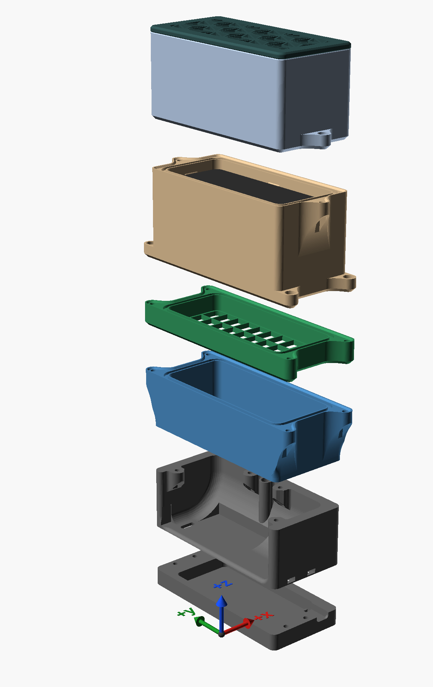

**It takes its HEPA as a cartridge:** a bought one, 80 × 40 × 15 mm, rests on a ledge in its holder. Or
the HEPA paper this build already has, pleated 20.2 mm deep, in the remix's frame (see *Your own HEPA
paper*). The cartridge chosen for the remix is a bigger one, the Xiaomi Mijia 1C / Dreame F9 robot vacuum's,
150 × 49 × 15 mm (Alon, 12 Oct 2026: D241); its holder waits for one measured in hand (see *A bigger bought
cartridge*). It replaces the paper (Alon, 14 Oct 2026: Q271): the glue frame is shelved with the clamp, still buildable, and the
HEPA holder and the cover as drawn wait to be redrawn round the cartridge.

**Every part the remix prints is drawn here** (Alon, 9 Oct 2026; the cover and the C-MAG too, D142), to the
originals' measurements, read by sectioning their STLs: the base, the tray and the fan section after the Auto's;
the carbon housing, the HEPA holder, the cover and the C-MAG after ThrutheFrame's. Sectioned both ways against the
originals, each matches them to a few hundredths of a millimetre where it keeps their shape; the text moulded into
the originals is left off. The cover's hemp-leaf pattern is drawn from its lattice, and the C-MAG's grills with
their honeycomb, which the author's project left to the slicer (see *The carbon*). None of the remix's parts needs
the author's files to build.

The remix adds four parts, takes its bottom from the BentoBox Auto, and seals the joints under suction:

| | What it does | File |
|---|---|---|
| **Section** | Goes between the carbon housing and the fan section, holding a flat filter sheet that stops carbon dust reaching the fans. Sealed at both its faces, with a pillar at each corner that the carbon housing's screws pass through. `sealed = false` builds it with the original's tongue, groove and magnets, to drop into any BentoBox v2.0 stack. | [`parts/section.scad`](../models/bentobox/parts/section.scad) |
| **Glue frame** (shelved) | One ASA frame your own pleated HEPA paper is hot-glued into, standing on the HEPA holder's ledge in place of the cartridge (T131, Alon, 9 Oct 2026). Shelved for the bought cartridge (Alon, 14 Oct 2026: Q271). | [`parts/paper-frame.scad`](../models/bentobox/parts/paper-frame.scad) |
| **Glue sample** (shelved) | One end of the glue frame: to glue an offcut in before the whole frame. | [`parts/paper-frame.scad`](../models/bentobox/parts/paper-frame.scad) |
| **Paper clamp** (shelved) | Two ASA frames, screwed together with a cut piece of pleated paper between them, standing on the HEPA holder's ledge in place of the cartridge: wedges from above and teeth from below pinch the paper's cut ends, and a bar from each its long edges. | [`parts/paper-frame.scad`](../models/bentobox/parts/paper-frame.scad) |
| **Clamp sample** (shelved) | One end of each frame, on one plate: to try the pinch on an offcut before the whole clamp. | [`parts/paper-frame.scad`](../models/bentobox/parts/paper-frame.scad) |
| **Base** | In place of the duct, drawn to the Auto's: the duct over the bay's roof, the wires' tube, the fans' four nuts pulled up into pockets in posts, and three nuts in slots for the tray's screws, two M3 and an M2; at the +Y end, the SPS30's pocket in the outlet's floor and the SGP41's recess in the end wall, its nut pushed in from the end face. | [`parts/bottom.scad`](../models/bentobox/parts/bottom.scad) |
| **Fan section** | In place of the fan case, drawn to the Auto's: its floor with the fans' openings and screws' holes, its top the sealed joint's, and its wires' hole opened out for the grommet. | [`parts/bottom.scad`](../models/bentobox/parts/bottom.scad) |
| **Tray** | The bay under the base, 8 mm tall: its floor and walls, the USB-C trigger board in a pocket in the -Y end with its socket flush with the end face, and four magnet holes; screwed on under the base with three screws, their heads sunk in its bottom face, and a nub on its top that slots into the base; a stop that holds the SPS30 in, and a groove for the sensors' leads. | [`parts/bottom.scad`](../models/bentobox/parts/bottom.scad) |
| **Carbon housing** | Drawn to ThrutheFrame's, with the sealed joints: a collar, the bead's groove and the nuts' tabs on top, the screws' tabs underneath. Its floor is a honeycomb across the whole inside, and the pellets lie on it, 45 mm deep, to a mark on each inside wall (D146); with `carbon = "cmag"`, the original's two openings, for the C-MAG. | [`parts/carbon.scad`](../models/bentobox/parts/carbon.scad) |
| **HEPA holder** | Drawn to ThrutheFrame's, its bottom sealed on the carbon housing, its pocket the box's whole inside, for a bigger piece of paper, and its top the original cover's, with its magnets, 6 × 2 mm here. To be redrawn round the bought cartridge (Alon, 14 Oct 2026: Q271), once one is measured. | [`parts/hepa.scad`](../models/bentobox/parts/hepa.scad) |
| **Cover** | Drawn to ThrutheFrame's hemp-leaf cover: its plate on the HEPA holder, the plug into the holder's top, the magnets' holes, and the window's pattern, drawn from its lattice of triangles. To be redrawn with the HEPA holder. | [`parts/cover.scad`](../models/bentobox/parts/cover.scad) |
| **C-MAG** | An option, with `carbon = "cmag"`, in place of the bed. Drawn to ThrutheFrame's: the tray and the lid, with the grills' slots and rails, the fill line and the magnets' bosses; and its four grills, with a honeycomb of holes the 4 mm pellets cannot pass. | [`parts/cmag.scad`](../models/bentobox/parts/cmag.scad) |
| **Bead ring** | Three, in TPU: the gasket in each sealed joint. | [`parts/joints.scad`](../models/bentobox/parts/joints.scad) |
| **Grommet** | One TPU donut that clicks into the fan section's floor, the fans' leads pushed through the skin across its hole, sealing the wires' hole. | [`parts/grommet.scad`](../models/bentobox/parts/grommet.scad) |
| **Fans' plug mate** | A block in the fan section that both fans' own plugs push onto, its pins the bared ends of 22 AWG solid wire. **On hold, not to print**, until the fan connector it copies is settled. | [`parts/fan-mate.scad`](../models/bentobox/parts/fan-mate.scad) |
| **Joint sample** | To print first: one end of a sealed joint, sliced off the parts, and a block with one fan nut's pocket - one ASA plate - and its bead, in TPU. | [`parts/samples.scad`](../models/bentobox/parts/samples.scad) |
| **Bottom sample** | To print first: the tray's -Y end with the USB-C board's pocket, and the base's floor over it with the tray's nut slots - one ASA plate. | [`parts/samples.scad`](../models/bentobox/parts/samples.scad) |
| **Sensor sample** | To print before the base (Alon, 14 Oct 2026: D264): the base's and the tray's +Y end, where the outlet's sensors go - the SPS30's pocket and the tray's stop, the leads' slot and groove, the SGP41's recess and its nut, the M2's slot and the nub - one ASA plate. | [`parts/samples.scad`](../models/bentobox/parts/samples.scad) |
| **Nut coupon** | Five fan-nut seats and five tray-nut slots at graded fits and with three kinds of end, to find the ones that hold on this printer (T181, T182). | [`parts/samples.scad`](../models/bentobox/parts/samples.scad) |
| **Sample plates** | Every sample on two plates, one ASA and one TPU, and a second ASA plate of the ones not yet tried (see *The samples*). | [`parts/samples.scad`](../models/bentobox/parts/samples.scad) |

Each part's source is under `parts/`, and the model is laid out as scad-tools' project layout says - [its README](../models/bentobox/README.md) has the files. Each printed part's own file, the one `scad-check.sh` and `printables.py` take, is written into `models/bentobox/.check/` by `sh scripts/tools/part-files.sh`.

**Not printed yet.** Every fit is checked in the model (see *Checking it*), not yet against printed parts.

## The carbon

**The pellets lie in the carbon housing** (Alon, 9 Oct 2026: D146), on its floor: a honeycomb across its whole
inside, 221 holes 3.2 mm across their flats, so 3.7 mm across their corners, under the 4 mm pellets, the webs two
beads wide, and 2 mm of solid floor round the edge, where the joint's bead presses. Pour them in with the HEPA
holder off, 45 mm deep, to the mark in the middle of each inside wall - 184 cm³, three times the C-MAG's line - and
level them: the air takes the thinner side of a bed. To change them, the housing comes off the stack, its four
M3 × 30 out, and tips out.

**The housing is 55 mm tall**, where the original's is 77.6, so the box stands 22.6 mm lower: 6 mm of air over
the bed is enough for the air from the HEPA holder's ledge to spread over it. It can be, because the top joint's
screws are in the middle of each end (D147), clear of the lower joints' screws at the corners.

**Why not the C-MAG.** The same airflow models as for the paper's pleats (see *How many pleats*), with the clamp at
18 pleats and the middle grade:

| The carbon | How much | Air through the box | ASA print hours until it is spent |
|---|---|---|---|
| C-MAG, filled to its line | 55 cm³ | 0.77 L/s | about 800 |
| C-MAG, trays full | 222 cm³ | 0.65 L/s | about 3,400 |
| No C-MAG: the housing filled 35 mm deep on a grid | 143 cm³ | 0.74 L/s | about 2,100 |
| **...45 mm deep: the remix** | **184 cm³** | **0.72 L/s** | **about 2,700** |
| ...55 mm deep | 225 cm³ | 0.70 L/s | about 3,400 |

- **A bed over the housing's whole inside does more with the same carbon.** Standing, the C-MAG's three trays are
  three layers one above the other, and they resist as one layer of their total depth would; its walls and the
  gap round it leave the pellets 35 cm² of the housing's 41. Spread over all 41, the carbon of a full C-MAG takes
  7 % more air through, and 45 mm of it holds more than three times the C-MAG's line for 7 % less air. Every grade
  of paper orders them the same way.
- **What the C-MAG gives instead is handling.** It lifts out of the housing once the HEPA holder is off, and it
  holds its pellets in place whichever way the box is turned.
- How long the carbon lasts is `scripts/analysis/carbon-life.py`'s estimate at 1.5 mg/h (see *How long the carbon lasts*).

**With the C-MAG** (`carbon = "cmag"`): the housing is the original's height, with the original's two openings in
its floor, and the C-MAG stands in it. The C-MAG is two halves that close on four grills.
Lying open, the grills stand across it and make three trays; the user guide says to fill each to a line
moulded inside it, 9 mm deep. Closed and stood on end in the housing, each tray's pellets fall onto the grill
below them and spread over the whole of the C-MAG's inside. That makes three layers, each about **5.35 mm
deep, one above the other**: about 55 cm³ of carbon in all. The LunchBox's bed holds 150 cm³.

**Filled to the top instead**, the C-MAG holds 222 cm³, and the airflow simulation says that costs a
seventh of the flow (see *The air through it*). The author fills it thin for the airflow; here the HEPA
cartridge, not the carbon, is what holds the air back.

**The grills are drawn with their honeycomb** (D142): 1.4 mm plates, each with 172 holes 3.2 mm across their
flats, so 3.7 mm across their corners, under the 4 mm pellets; the webs between them are two beads wide, and a
rim six beads wide goes round them, of which the rails hide the outer 2.1 mm. That leaves 46 % of a grill open.
The author's grills are solid plates in their STL, which the slicer settings in his project turn into a
honeycomb about half open; the drawn ones print the same in any slicer.

## The section

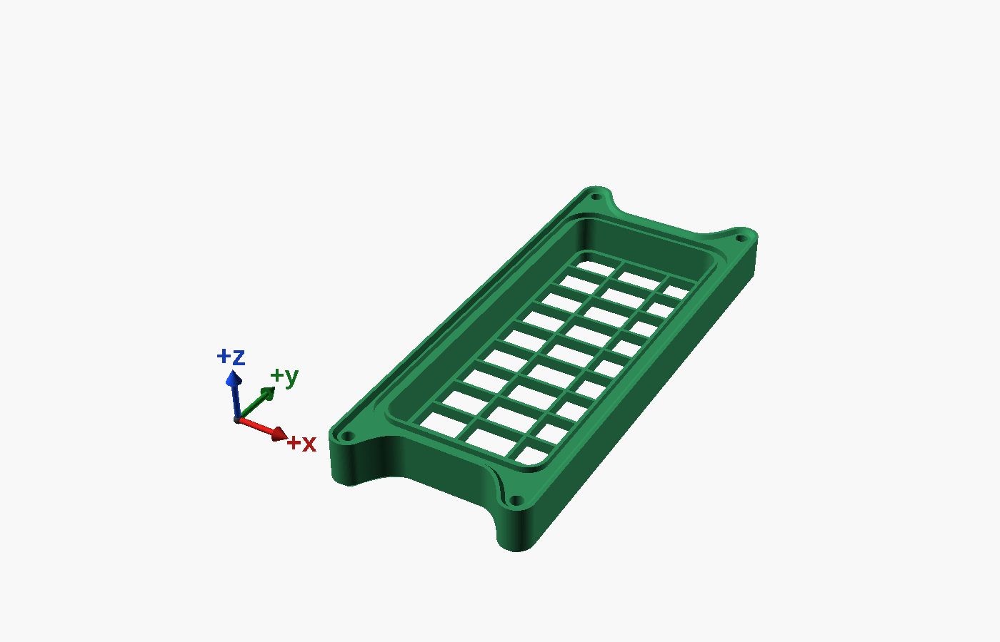

The sheet lies on a grid at the section's bottom, with 5 mm of air above it. The carbon housing's floor has
an opening over each fan only, and that air spreads over the whole sheet before it goes through. Below the
grid is the fan section, with 11 mm of air above the fans.

**The sheet:** polyester filter floss, about 5 mm thick loose, cut to **42 × 102 mm**: a little over the
section's inside, 40.8 × 100.8, so it seals at its edges on the ledge round the grid. It is there for carbon
dust, which is coarse, so it needs to be open, not fine. Change it when it turns grey.

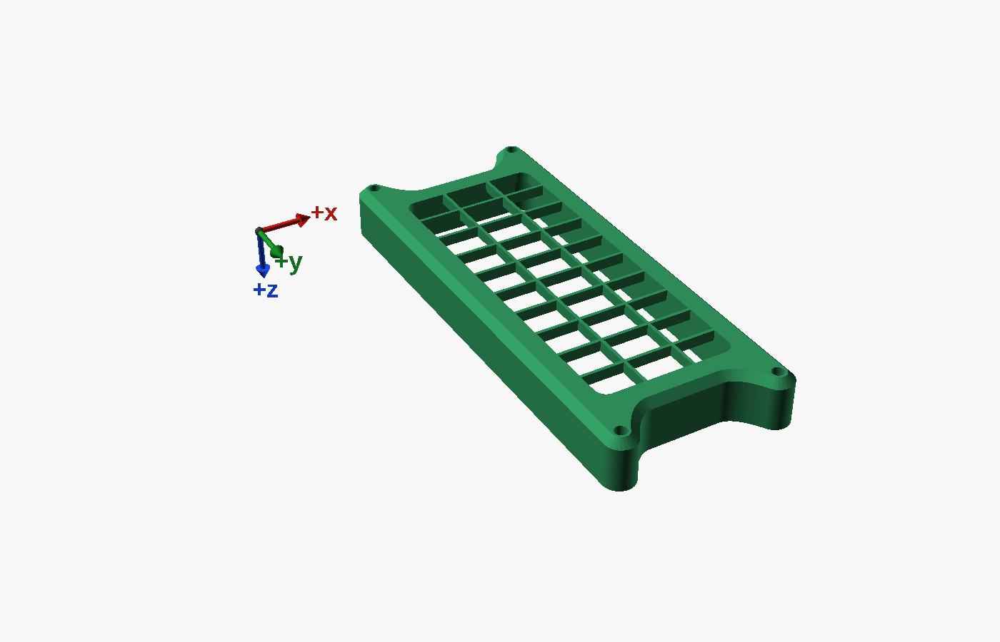

**No magnets:** both its joints are sealed (see *The sealed joints*), and the carbon housing's four screws
hold it, through its pillars, to the fan section.

## The bottom

The bottom is drawn here, from scratch (Alon, 9 Oct 2026), to the measurements of Strangwooduk's base and fan
section, from the [BentoBox Auto VOC Sensor system](https://makerworld.com/en/models/1882240), a remix of
ThrutheFrame's box.

- **The base is ThrutheFrame's duct** with its floor raised about 11 mm over a **bay for the electronics**, as
  the Auto's is: the floor flat from the outlet, then turning up into the +X wall on a 26 mm radius; the inside's
  edges rounded 6 mm; the walls 7 mm; the outlet's rim rounded 2.5 mm. Sectioned both ways at nine cuts, the
  drawn duct is the Auto's to about 0.05 mm. It has none of the Auto's lugs, cable ports or step.
- **The bay** is 40.8 × 82.8 mm and 8 mm tall (Alon, 9 Oct 2026), where the Auto's is 5.5: the boards in it lie
  flat with wires over them. The box stands 2.5 mm taller for it, 48.5 mm where ThrutheFrame's duct is 52.
- **A tube carries the wires down**: a 6 mm hole in the fan section's floor between the fans, and a tube
  under it, against the +X wall, straight down to the bay. The two fans' leads go down it; a 4.5 mm bundle
  passes.
- **The air leaves the same way**: out of the whole long side, 101 × 37 mm (3,700 mm²) where the duct's
  opening is 74 × 46 (3,400 mm²). Both are larger than the fans' own two 37 mm openings, and the HEPA, not
  the duct, sets the flow, so the airflow below, simulated with the duct, should hold within a few per cent.
  The simulation will be run again with this base before the remix is published.
- **The fan section is the Auto's, drawn**: the fan case's walls and inside, and its floor with each fan's
  37 mm opening and the 3.4 mm holes for its screws. Its top is the sealed joint's (see *The sealed joints*). Each fan is held by two screws, at opposite corners,
  down through the fan section's floor into the base.

The Auto also has a spacer for a sensor between the HEPA holder and the carbon housing, and a 24 V
controller in the bay. Neither is used here. This build's sensors (the same as the
[air-quality monitor's](https://github.com/AlonRR/air-quality-monitor), an SPS30 and an SGP41) will go
**in the base's outlet**, where they read the air after the carbon; the chamber's own monitor reads the air
before it. Where each goes is below.

The SPS30 cannot go between the fans instead (Alon asked, 14 Oct 2026). Cut from the fan section's mesh, the
space there is 20 mm along the box, between the two fans, 40.8 mm across, wall to wall, and 31.6 mm from the
floor to the fan section's top. The SPS30 is 40.69 × 40.6 × 12.2: standing on its edge in the gap, one of its
long sides goes across, leaving 0.2 mm of the 40.8, and the other stands 40.7 tall, 9 mm more than there is;
the wires' grommet stands in the gap too. Above the fans there is 11.6 mm under the carbon housing, against its 12.2 mm, and it would sit over the
fans' intakes. The SGP41, 13.1 × 10.6 × 3.2, would fit there, but its four leads would need room in the grommet,
which takes the fans' four.

**The SPS30 lies on the outlet's floor, in a pocket** (Alon, 14 Oct 2026: D247, D252), cut in the base
(`sps30_cut` in [`parts/bottom.scad`](../models/bentobox/parts/bottom.scad), its values in the params' *The outlet's
SPS30* and in [`vitamins/sensors.scad`](../models/bentobox/vitamins/sensors.scad)). The floor is flat for only
19.8 mm in from the outlet's face before it turns up into the +X wall on a 26 mm radius, and the SPS30 is 40.6
deep, so the pocket cuts the turn back to the floor. Laid on the flat floor instead, 20.8 mm of it would stand out
past the face. It blocks 14 % of the outlet, under the +Y fan.

How it lies follows Sensirion's rules, as the [air-quality monitor](https://github.com/AlonRR/air-quality-monitor/blob/main/docs/design.md)
lists them. Its two inlets and its outlet grille are all on one 40.69 x 12.2 face, the inlets at one end and the
grille at the other; its connector is on the face opposite, near the outlet end.

- **Label up**: one inlet wraps round onto the label face's edge, so that face stays open.
- **Its openings face the duct's middle (-Y)**, into the moving air, with the inlets at the back, upstream, and the
  grille at the front: the duct's air carries what the grille blows out away from the inlets. In front of them the
  turn is cut back 10 mm too, as far back as just past the inlets, short of the fans' wires' tube, so they face open
  air. Sensirion's best is openings facing down; that needs it on edge, 40.6 tall, and the duct is 36.
- **Its connector side lies flush along the +Y end wall** (Alon, 14 Oct 2026: D255, D257, D259), its face 0.2 mm
  off the wall's. An M3 tray screw under it would not let it: an M3 nut's slot reaches 0.5 mm in under the duct's
  edge, where the pocket takes away the fillet that covers it. So the +Y end's one tray screw is an M2, whose
  smaller nut and head let it stand 0.85 mm further out, its slot two beads clear of the pocket.
- **Its plug sits flush in its face**, and the leads, turned down out of it, reach 1.95 mm out (Alon measured both,
  14 Oct 2026: Q256). They turn down in a slot that runs 2.25 mm out from the connector face, 2.05 mm into the
  wall, which keeps 4.95 mm behind it. The slot is open to the outlet,
  so the SPS30 slides in from the front with its lead on, and runs down to the base's bottom face.
- **Its lead goes down the slot and along a groove in the tray's top into the bay**, to the ESP32: the bay stops at
  Y 41.4, 8 mm short of the end wall, so the slot alone does not reach it. The groove is 6.2 mm across and 1.5 deep.
  The +Y end's -X tray screw moved from X -13 to -7, out of the slot's way.
- **It does not stand out**: its front is 2.2 mm inside the outlet's face, and its back 2.4 mm short of the +X wall.
- **The tray holds it in**: a stop on the tray's front wall, 1.8 mm thick and 10 wide, comes up through a notch in
  the floor's front edge and stands 5 mm over the floor in front of it. Put the SPS30 in, its lead down the slot,
  then the tray on; the tray off lets it out. It sits with 0.2 mm round it, the monitor's tried fit.
- **Checked** (`check_sps30*`): the SPS30 clear of the base and the fan section; the plug in the end wall's slot; 10
  mm of open air in front of its openings; its leads down the slot and along the groove into the bay, clear of the
  base, the tray and the SPS30; its way in from the outlet with the tray off; the wires' tube left whole; the stop
  clear of it in place, and in its way 1 mm out. Each has a control that the check catches.
- The duct's air past it: at the simulated 0.65 L/s, the outlet's mean is about 0.2 m/s, under Sensirion's 1 m/s.
  The simulation predates the pocket. Keep the ESP32 out from under it in the bay: Sensirion wants the sensor away
  from, and below, a warm board.

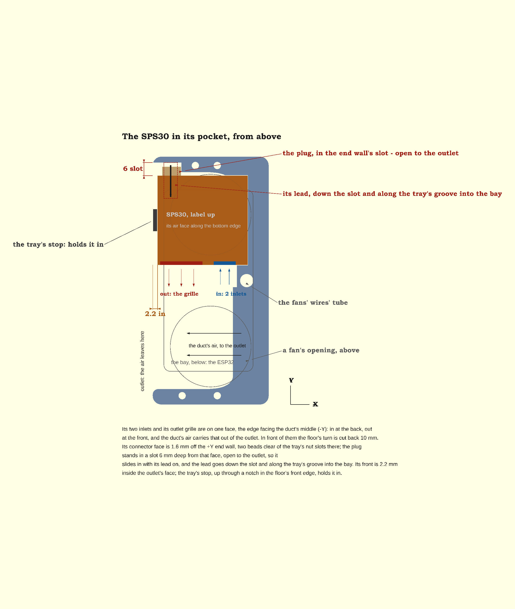

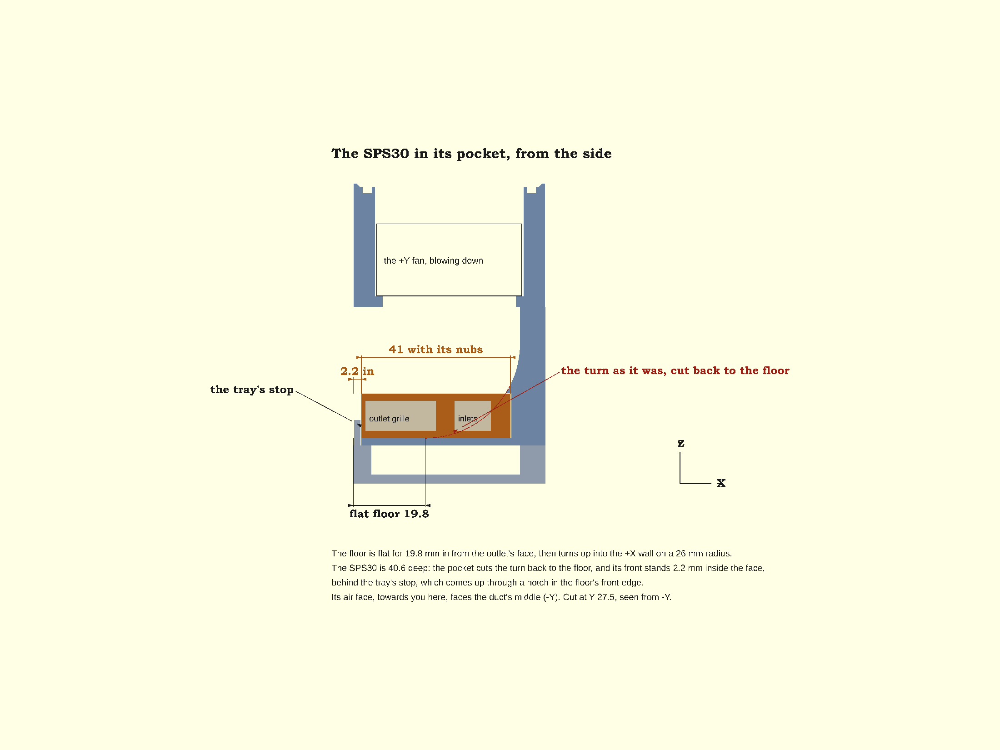

**The SGP41 goes beside the SPS30, its leads down the same slot** (Alon, 14 Oct 2026: Q248, A258). It sits in a
recess in the +Y end wall over the SPS30 (`sgp41_cut` in [`parts/bottom.scad`](../models/bentobox/parts/bottom.scad)),
its long side along X, its pins towards the outlet and its sensor facing the duct, in the air the +Y fan blows down
to the outlet. It stands behind the fan screw's post on that wall, so the post is over neither its sensor nor its
screw, and the recess's ceiling slopes up 45° to the wall's face so it prints without support.

- **Held by a nut** (Alon, 14 Oct 2026: A260): an M2.5 × 8 through its hole into an M2.5 nut in the end wall. Its
  far end, where its underside is bare, bears on a rib in the recess; the screw goes on through the rib and 1.2 mm
  of wall into the nut's pocket, which runs out through the end face, a corner up so it needs no bridge. Push the
  nut in from outside: it stops in a tight seat, as the fans' pull nuts do, and the screw pulls it home. The screw
  stands 2 mm out of the nut and its tip reaches the end face, so the module stands 1.71 mm proud of the wall. A
  nut, not a self-threading pilot as on the air-quality monitor: the monitor tried a sideways pilot once, and its
  peg did not print, so no sideways pilot size was ever found.
- **Its leads** go down a bay at its pin end into the SPS30's slot, which now runs on to the SGP41's pin end, then
  along the tray's groove into the bay with the SPS30's: the groove is 13.7 mm across and 1.9 deep, for the
  SPS30's five 1 mm leads and the SGP41's four 1.56 mm ones side by side. The bay is wide enough for the four side
  by side only low down, under the fan screw's nut pocket in that post.
- **Checked** (`check_sgp41*`): clear of the base, 5 mm of open air in front of its face, and its four leads down
  the bay, the slot and the groove into the bay, clear of the base, the tray, the SPS30 and itself.

**The tray at the +Y end** (Alon, 14 Oct 2026: D257, D259): one screw, an M2 × 16, at X 3, where there were two
M3s; in the other's
stead a nub on the tray's top, 3 mm across and 2 tall, slots into a hole in the base's bottom face, at X 12. The
sensors' lead slot runs where the other screw was.

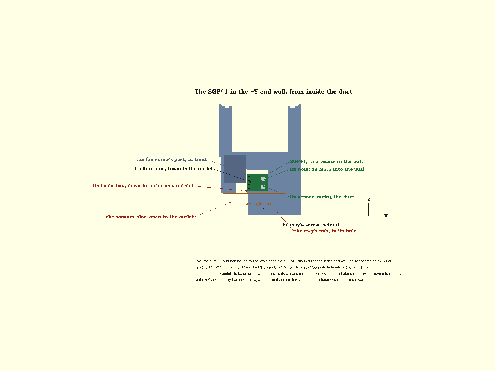

**Not upright against the back wall, openings down** (Alon asked, 14 Oct 2026), though that is Sensirion's best
way round. Upright it is 40.6 tall, with open air wanted under its openings, and the duct is 36 from floor to fan
section; at the back the floor curves up into the wall, which is flat for only its top 10 mm, and above it the fans
fill the fan section to the wall. Sunk into the curve and the bay instead, its openings would face the bottom of a
slot, in still air or the bay's, not the filtered air leaving the box.

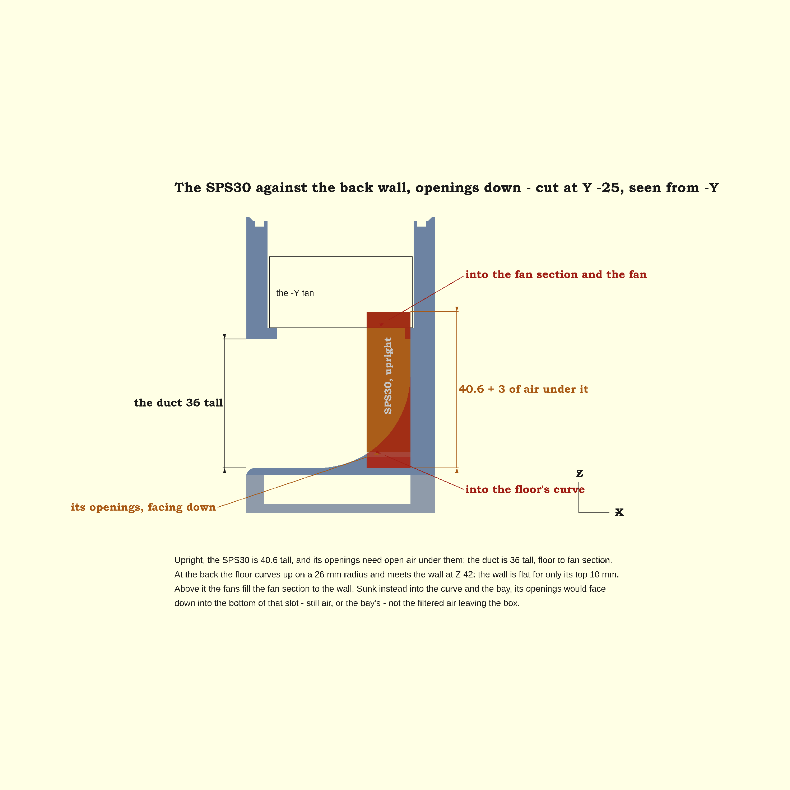

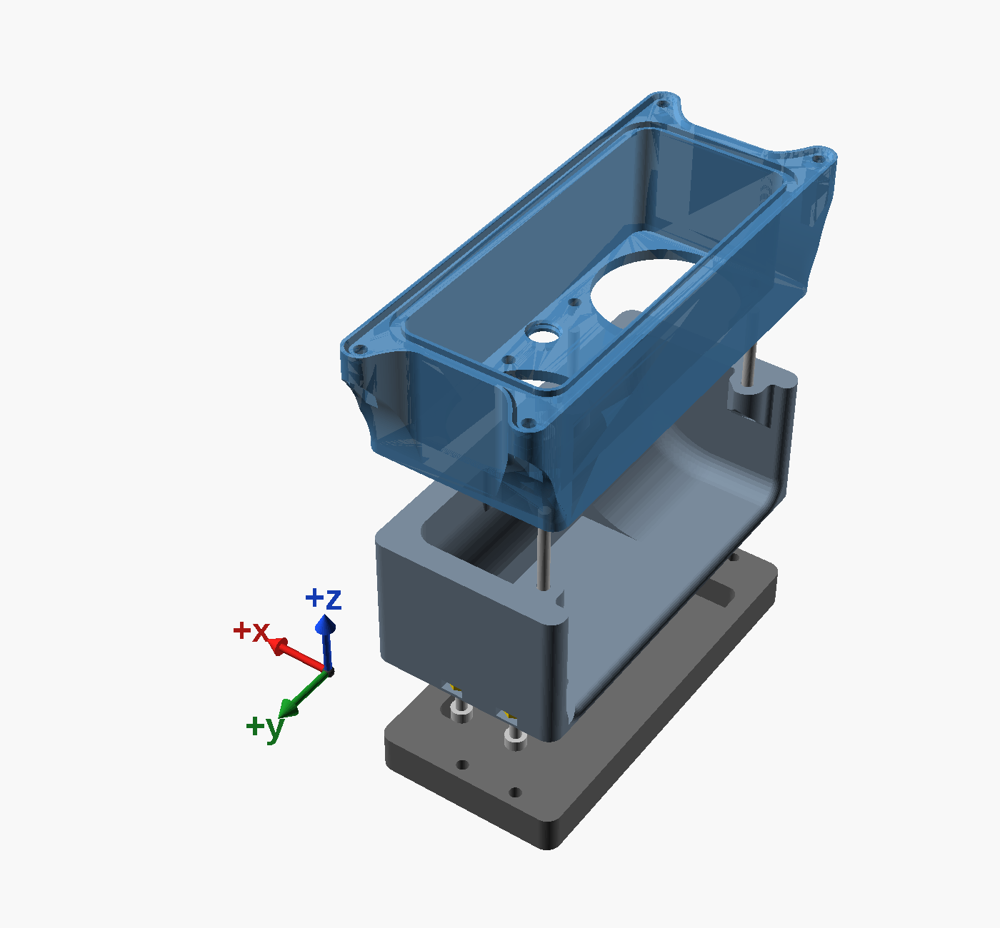

**Nuts, not heat-set inserts.** The fans' nuts are pull nuts; the tray's lie flat in slots that open one way.

- **The fans' four screws**, M3 × 30, come down through each fan and the fan section's floor into a pull
  nut, in a post: round at its end, its sides on fillets into its wall, straight down and then on a round into a
  45° underside that meets the wall, and cut back clear of the fan's air - round, it would reach 0.69 mm in under
  the edge of the fan section's floor opening. A hex pocket runs up it on the screw's axis, open under the post,
  into a tight seat 2 mm under the base's top, 5.7 mm across its flats as cut (T189: the nut coupon); a screw
  from above pulls the nut up into the seat, and it stays there. Each pocket has a flat 5° off the nearer fan, so it keeps 0.9 mm of wall to the fan's air, and 0.14 mm
  to its wall's face.
- Each nut pocket's roof, and each slot's, starts with two bridging layers, a channel and then a square, so the
  screw's hole prints over it without support.

**The tray.** The base splits at the bay's roof, so that both halves print flat: the base standing on its floor,
the tray on its own floor, open at the top. Printed whole, as the Auto's is, the bay's roof would be a bridge 41 mm
across and 83 long.

- **Its three screws** - two M3 × 12 at the -Y end and an M2 × 16 at the +Y end (D259), socket head - come up
  through counterbores in the tray, their
  heads sunk 0.2 mm inside its bottom face, into nuts in slots in the base's end walls, just over the bay's
  roof. Each slot opens out through the end face: a nut goes in from outside and slides to the slot's end, on
  its screw's axis. The slot's end is the nut's own shape, so the nut beds against four walls and stays in
  (T189: the nut coupon). Each screw's hole runs on up past its tip, so anything up to M3 × 20 fits
  (`tray_screw_max`; D213). A slot has 0.8 mm under it, four layers, which the nut presses onto the tray's top; low like
  that, its back keeps two beads under the end wall's fillet. The screws stand clear of the magnets' holes and,
  at the -Y end, of the USB-C board's pocket.
- **The USB-C socket** (Alon, 9 Oct 2026). A USB-C PD trigger board takes 12 V from a charger for the fans, and
  a step-down makes 5 V from it for the ESP32. On the charger this build uses, the board gives 12 V (Alon
  measured it, 9 Oct 2026). The board - as Alon measured it, 14.51 mm long with its socket,
  9.97 wide and 1.05 thick, the socket 8.96 × 3.25 and standing 1.55 past the board's edge - lies in a pocket in
  the tray's -Y end, its socket's face flush with the end face: the wall in front of the board is 1.55 mm thick,
  and the board's edge rests against it. The socket goes through a notch open at the top, the board drops into
  its pocket from above, and the base's flat bottom closes both, 0.1 mm over the socket. Behind the board,
  between its two pads, a stop on the bay's floor takes the plug's push. The socket's axis is 8.8 mm over the
  bottom face, so a plug's moulding clears whatever the box stands on.
- **In the bay**, not drawn yet: the step-down (an MP1584EN, 5 V out), an ESP32-C3 SuperMini, and an IRLZ44N
  that switches both fans from the ESP32 (Alon, 9 Oct 2026), a diode across them; the fans' tach wires go to
  two of the ESP32's pins. Lying flat, they fit the 8 mm. The outlet's SPS30 takes its 5 V from the same
  step-down, beside the ESP32 (Alon, 14 Oct 2026: D249): it draws 45 to 65 mA, 80 mA for the first 200 ms as
  its fan starts, against the MP1584EN's 3 A. Its SEL pin goes to ground, for I2C. The SGP41 goes on the
  ESP32's 3V3, never 5 V, as in the air-quality monitor. Before wiring, check that the charger offers 12 V:
  many offer 5, 9, 15 and 20 V only. The SuperMini's firmware is
  [`firmware/bentobox.yaml`](../firmware/bentobox.yaml), with the pin for each wire in its header: flashed
  9 Oct 2026 and updated over the air since, it reports to Home Assistant over MQTT, and the fans are on unless
  switched off there.

  

  The circuit, drawn by [`scripts/figures/bentobox-circuit.py`](../scripts/figures/bentobox-circuit.py) (`uv run
  scripts/figures/bentobox-circuit.py`) - its pins are the firmware's, so a change goes into both. The fans share the
  one switch, their reds joined and their blacks, in the fan section (D154). Each tach goes through a 1N5819,
  its band towards the fan: the switch is on the fans' black side, so when it is off their ground floats up to
  12 V and the tach line with it, and the diode keeps that off the pin.

**Putting it together:** the USB-C board into its pocket, its wires soldered on; a nut in each of the three slots
in the end faces, pushed to the slot's end. The outlet's sensors next, with the tray off and the fan section not
on yet: the SGP41's M2.5 nut pushed into its seat from the +Y end face; the SPS30, its lead plugged in, slid in
from the outlet's face, the lead bent down the end wall's slot; the SGP41 into its recess, its leads down the bay
into the same slot, and its M2.5 × 8 driven from inside the duct with a 2 mm L-shaped hex key, which pulls the nut
home; all the leads laid along the tray's groove. Then the tray under the base with its three screws, its stop up
in front of the SPS30; it comes off again from below, for the electronics, and lets the SPS30 out. Then the fans'
nuts, from the open top of the base: slide each nut in under its post, push it up the pocket, and pull
it into the seat with a spare M3 screw from above; take the screw out, and the nut stays. The fans' leads down
the tube; the fan section on the base, the fans in it, and their four screws down through them. The seat's
fit was found with the nut coupon (T189; see *The samples*).

**Magnets:** none at the fan section's top, whose joint is sealed. The tray's underside has four holes for
6 × 2 mm magnets, where the Auto has its 4 × 2; magnets there would hold the box to a steel floor. They are optional.

**Seal the wires' hole.** The hole in the fan section's floor opens above the floor, into the fans' intake,
the lowest pressure in the box, about 97 Pa under the chamber's. The tube under it opens into the bay, and
the bay is open to the chamber at the tray's joint, round the USB-C socket, and wherever wires leave it. Air
drawn in that way passes neither filter. Through the 6 mm hole with the fans' leads in it, as an orifice,
that is up to about 0.09 L/s, a seventh of the flow. The LunchBox's wire hole had the same fault, and it let in a
fifth of its air. So the leads pass the floor in a **grommet** (Alon, 9 Oct 2026):

- **One TPU donut** (Alon, 9 Oct 2026, in place of two halves that closed round the leads), its hole for the
  leads 4 mm across. Across that hole, at the grommet's foot, is a thin skin, two layers, with four holes in it,
  1.55 mm as they print, one for each lead (Alon, 9 Oct 2026). Four leads pass, not six: the fans' reds are joined
  in the fan section, and their blacks, and each fan's blue passes on its own (D154). Four such holes do not fit
  inside the 4 mm skin with skin left between them, so they stand out by the ring, as close as leaves two lines
  of skin between neighbours, centres 1.94 mm off the axis; each runs on up the ring's inside as a groove, 0.87 mm
  deep, so its lead goes straight up, and leaves at least 1 mm of ring behind it. It prints on its foot, the skin
  on the bed, and needs no support. `grommet_skin = 0` leaves the hole open instead.

  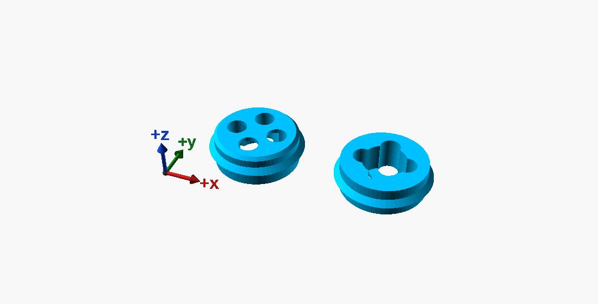
- **The floor's hole is opened out to 7.6 mm** for it, 0.8 mm off the tube's axis towards -X so it stays clear of
  the fan section's +X wall, with a groove round it at mid-height, 45° each side, and a 0.6 mm chamfer at the top,
  its entrance. Round
  the grommet, a lip with 45° sides clicks into the groove. The grommet is 0.1 mm proud of the hole all round, so
  it seals, and as thick as the floor, 3 mm, so it sits flush both sides.
- **Putting it in:** the grommet first, with nothing through it, so its hole can give as the lip passes: pushed
  down into the floor's hole from inside the fan section until the lip clicks into the groove. Then, from inside
  the fan section, each of the four leads down its own groove, through its hole in the skin, and on down the
  tube into the bay.
- **The fans' plugs stay in the fan section**, pushed onto their mate (below). Each is 8 mm across, a 2.54 mm
  KK 254-style housing, wider than the floor's 7.6 mm hole and the 6 mm tube, so only the mate's four leads pass.

**The fans' plug mate** (Alon, 9 Oct 2026). **On hold, not to print** (Alon, 11 Oct 2026): it copies the
[fan connector](https://github.com/AlonRR/fan-connector)'s male, which is still being tried in print, and will take
its hold and sizes once that is settled; `bentobox-print.sh` leaves it out until then.
Each fan keeps its own 3-pin plug and pushes it onto a printed block in
the fan section, so a fan comes out by unplugging it.

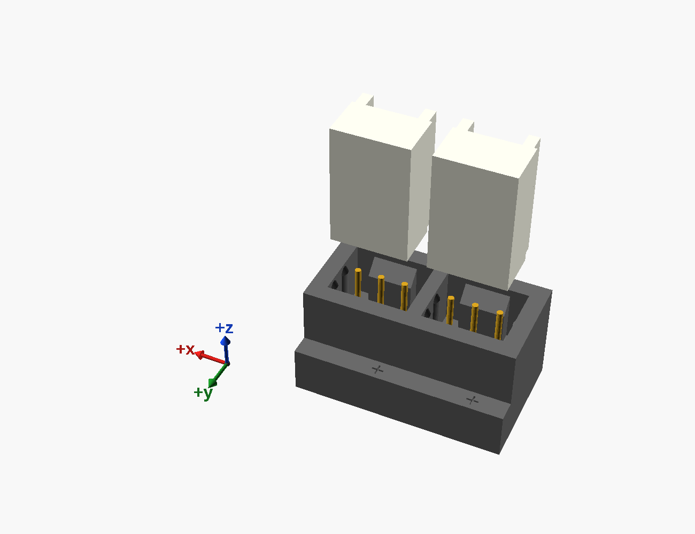

- **The pins are the wires.** 22 AWG solid wire (owned, the 5-colour UL1007): its bare core is 0.64 mm, a
  header pin's size. Bare each wire 8 mm, push it up through the block from below until its insulation stops
  in its slot's roof - it cannot pull out upwards - and its core stands 6 mm above the block as the pin. The roof
  slopes up at 45 degrees and leads the core into its hole: under the flat roof the fan connector's male first had,
  the holes printed closed (T188, 10 Oct 2026).
  Under the block, bend each wire over into the groove to the back edge. Once the block is fixed down, that bend
  stops a pin being pushed down when a plug goes on; until then, a drop of glue in the slot does it.
- **One way on.** A wall stands behind each plug's ribbed face, and a key on it goes between the plug's two ribs,
  so the plug only goes on with its text face to the front. A wall at each end of the block, one between the plugs
  and one in front of each plug's text face (Alon, 9 Oct 2026) close each plug in on all four sides; joined at the
  corners, they stiffen one another. A **+** in front of each plug marks the red wire's pin; the plug's own moulded
  arrow lands over it.
- **Friction holds each plug on**, as on the fan connector's male (Alon, 10 Oct 2026: "no spring, friction fit").
  Two round ribs stand up the wall at each end of each plug, biting 0.15 mm into its end faces; their tops lean back
  into the walls, a lead-in for the plug. That bite is the male's first guess: the fan connector's grip coupon finds
  the one that holds on this printer, and `fan_mate_grip` takes the same value. The mate first had the male's
  spring front wall and a clip over the plug's lip: on the printed males the front wall as the spring was too weak
  to press, and on the back one the clip snapped off.
- **From the plug as measured** (Alon, 9 Oct 2026): 8.0 mm across its pins, 5.2 thick over a 0.3 mm lip across its open end (4.9 behind it), 6.67 over its ribs, the
  ribs 1.1 wide with 5.2 between them, its holes 1.45 mm and their nearer walls 2.55 mm from the text face. The
  key is 4.7 wide, 0.25 mm of play each side of the plug.
- **Both fans on one block** (`fan_mate_n = 2`; Alon, 9 Oct 2026: D160): their reds are joined under it, and their blacks, and
  four leads go on down through the grommet (D154). `fan_mate_n = 1` draws a block for one plug.
- **The cores' holes print small.** They are cut 0.94 mm for a 0.64 mm core; if one closes up, open it with the
  wire itself or a 0.7 mm drill.
- **Where it sits** (Alon, 9 Oct 2026: D162): on the fan section's floor, between the two fans and beside the
  grommet, 2 mm towards -X of the middle, its back - where the leads come out - towards the -Y fan. It stands
  about 18 mm tall with a plug on it, under the 30 mm to the section above, and is glued down. The checks keep
  it clear of the fan section, of both fans' frames and of the grommet's hole and the way up out of it.

## The sealed joints

The joints between the HEPA holder and the fans, three of them, are under suction: the air under the HEPA is
about 87 Pa below the chamber's, under the C-MAG 93, over the fans 97. Chamber air that leaks in at one of
them passes the filters above it. A 0.1 mm gap round a joint's 300 mm lets in about 0.03 L/s, 5 % of the
flow, and the leak grows as the gap's cube. The cover's joint has the chamber's air on both sides, and the
base's is downstream of the fans, so those two stay as they are.

So the section on the fan section, the carbon housing on the section, and the HEPA holder on the carbon
housing are sealed:

- **A bead in a groove.** A hollow TPU bead, 2 mm, its wall one perimeter, after
  [scad-tools' gasket](https://github.com/AlonRR/scad-tools/blob/main/lib/gasket.scad), lies in a groove
  2.5 × 1.6 mm in the lower part's top, round the inside. It stands 0.4 mm proud; the upper part's flat
  bottom presses it down as the two faces meet, a fifth of its height. Its hollow is vented through its
  inner wall, to the box's inside: a dead end, and the outer wall and the ridge seal. On the joint sample the
  bead printed about 0.2 mm under its drawn height and still sealed (T131; see *The samples*).
- **The upper part sits in the lower one.** A collar 1 mm tall runs round the lower part's top edge, round
  the tabs too, its inner face at 45 degrees; the upper part's bottom edge, tabs and all, is cut back at 45
  degrees to sit in it, 0.2 mm clear. It centres the parts, and it is a second barrier outside the bead. Both
  print without support.
- **Tabs and screws, where the magnets were.** The two lower joints have a tab at each corner; the top joint,
  the HEPA holder on the carbon housing, one in the middle of each end (Alon, 9 Oct 2026: D147), so nothing stands
  over the lower joints' screws, which go in first. Each tab stands 9.4 mm past the end wall.
  The tabs are seamless with the walls and floors: each part's outline is one shape, tabs and all, so a
  corner tab's side runs straight on from the side face, a tab's outline leaves the end wall along a parabola,
  tangent to it - on both sides of a middle tab - and its floor or top is the part's own. For that the originals' outsides are cut 0.05 mm inside
  their own faces, a quarter of a layer, and their floors and tops at a sealed joint likewise. Under each
  nut's tab, a bracket whose face is a cubic in its height: tangent to the wall at its foot, 45 degrees at
  the tab, so it prints without support. In the rounded corner under a corner tab it fills the corner
  smoothly, so the side face runs on into the bracket's side. The fan section is shorter than a bracket, so its
  brackets run down to its bottom.
- **Pull nuts** (Alon, 11 Oct 2026: D213), as the fans' are in the base. Each nut sits in a seat in the middle of
  its tab's height, 5.7 mm across its flats as cut (the nut coupon's seat 3), under a roof 1.6 mm thick, a flat
  towards the wall. Under the seat, its pocket runs straight down through the tab and the bracket under it and out
  of the bracket's face, 0.1 mm looser: the nut goes up it from below and is pulled into the seat. The pocket is
  open below, so a screw longer than the shortest that reaches runs on down it: the build's M3 × 30 where an
  M3 × 25 would do. It leaves 0.94 mm of the tab's boss round its corners, and 2 mm of bracket to the end wall.
- **The screws.** Two M3 × 12 through the HEPA holder's tabs into nuts in the carbon housing's. Four
  M3 × 30 through the carbon housing's bottom tabs and pillars in the section into nuts in the fan
  section's: one screw at each corner holds both of the section's joints. Each length is the shortest of
  `screw_lengths` - the M3 lengths at hand, 8, 12, 16, 20 and 30 mm - that stands 1.5 mm out of its nut. Each head sinks flush into a
  counterbore in its tab, 0.2 mm under the top: the upper parts' tabs stand 8.2 mm, 5 mm of it under the
  head. They are socket heads, turned with a 2.5 mm hex screwdriver (Q148).

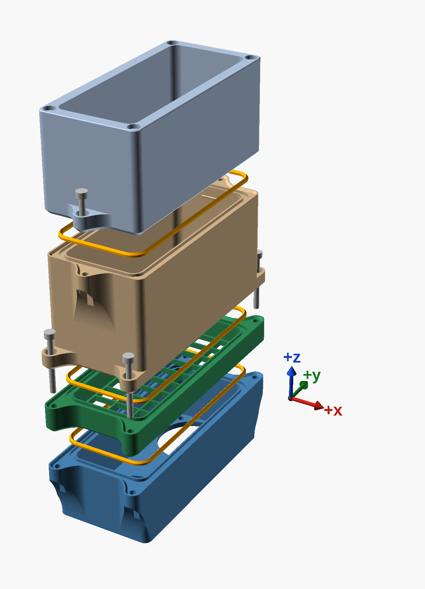

**Putting it together:** a bead ring in the groove on the fan section, the section and the carbon housing;
a nut in each tab of the fan section and the carbon housing - pushed up its pocket from under the tab, pulled
into its seat with a spare M3 from above, and the screw taken out again; the section on the fan section, the
carbon housing on the section, and the four M3 × 30 down through them, with a 2.5 mm hex screwdriver, straight down:
nothing stands over them. Then the HEPA holder on the carbon housing and its two M3 × 12, and the cover on its
magnets. The checks stand a screwdriver with a 75 mm blade and a 30 mm handle on every head, straight up, the lower
screws' before the HEPA holder is on, and find nothing in its way.

The sheet in the section, the carbon and the HEPA come out by the same screws. Only the cover's joint keeps
magnets: four in the HEPA holder's top and four in the cover. They are 6 × 2 mm, where the original's are 4 × 2
(Alon, 11 Oct 2026), each moved 0.76 mm in from its corner along the diagonal, so that the wall inside it and the wall
outside it, at the top's 0.4 mm chamfer, are the same: 0.93 mm, two lines. `magnet` sets their size.

**Try one end first.** The bead's size and the seat's fit were first guesses, and the carbon housing is a
6-hour print. The joint sample is one end of the joint between the carbon housing and the HEPA holder, sliced
off the parts themselves: the carbon housing's top 12 mm, with its nut tab, and the HEPA holder's bottom
10 mm, with its counterbored tab, 30 mm in from the end wall. With them on the plate is a block holding
one fan nut's pocket as the base has it. Lay the TPU bead in the lower piece's groove, pull a nut up into its tab's seat
with a spare screw, set the upper piece on in its collar and drive the M3 × 12: the faces should come together on the bead,
pressing it down, the chamfer should sit in the collar, and each head should end flush. Pull a nut into the
block's seat with an M3 × 8 and take the screw out: the nut should stay.

`sealed = false` in [`bentobox.params.scad`](../models/bentobox/bentobox.params.scad) builds every part as
the original has it: magnets, a tongue on each top, a groove under each bottom.

## A bigger bought cartridge

Alon, 12 Oct 2026 (D241): a bought cartridge bigger than the original's, the holder grown round it. The HEPA
sets this box's flow (see *The air through it*), and what sets the HEPA's resistance is how much paper it holds:
its face times how deep it is pleated. So a bigger frame pays only if it carries more paper than the glue
frame's 37.4 × 94.1 mm pleated 20.2 mm deep, and its grade matters as much as its size. The cartridges looked
at, sized as their sellers give them:

| Cartridge | Size, frame included | Pleats | Grade, as sold | The holder it needs |
|---|---|---|---|---|
| **Xiaomi Mijia 1C / Dreame F9 robot vacuum: chosen** | 150 × 49 × 15 mm | up to 15 mm | 99.5 % at 0.3 µm | about 50 mm longer and 8 mm wider than the box's inside: past the box by about 19 mm at each end and 4 at each side |
| Roomba 800 / 900 | about 111 × 52–54 × 10–13 mm | about 10 mm | iRobot's own: 99 % at 10 µm, not HEPA; others' "HEPA" unverified | about 13 mm wider and 10 mm longer; [two](https://www.printables.com/model/896307-bento-box-larger-hepa-filter-remix) [remixes](https://www.printables.com/model/551032-voron-24-roomba-800900-hepa-filter-box) already take it |
| iLife V3 / V5: the original's | 80 × 40 × 15 mm | 15 mm | not stated | none, the original's ledge. The glue frame's paper moves 18 % more air on the middle grade, less on the 300 Pa one (see *How many pleats*) |
| Your own paper, in the glue frame | 100.5 × 40.5 mm | 20.2 mm | not known | none: drawn |

- **The Mijia cartridge is the only one sold with a HEPA grade**, and if its pleats are spaced like the paper's
  it holds about a fifth more. Its holder, and the cover with it, run past the box's ends.
- **It is not drawn yet.** Its size is a seller's title, and a cartridge's frame has a lip, tabs or a handle a
  listing does not show, so the holder waits for one measured in hand. The paper does not stand in meanwhile
  (Alon, 14 Oct 2026: Q271): the glue frame is shelved, and the HEPA holder and the cover wait for this one's holder. [`vitamins/hepa-cartridge.scad`](../models/bentobox/vitamins/hepa-cartridge.scad) keeps the
  original's 80 × 40 × 15: the airflow model's HEPA zone is drawn from it.

## Your own HEPA paper

**Shelved** for the bought cartridge (Alon, 14 Oct 2026: Q271), and kept buildable, as the clamp is.

Pleated HEPA paper off a roll can take the bought cartridge's place. The original holder's pocket is
82 × 40.8 mm, sized for the 80 mm cartridge: its ends are solid, flaring out only 15.6 mm above the ledge. The
remix cuts the pocket out to the box's whole inside, 100.8 × 40.8 mm with its rounded corners, from the ledge
up, and the ledge's opening with it, to 87.5 × 36.8 mm (78 × 36.8 on the original).

### The glue frame

Alon, 9 Oct 2026 (T131): the clamp's wedges and teeth printed thin and fragile from ASA that was not dry, so the
paper is hot-glued into one frame instead. The clamp is shelved until the filament is dried, and still builds
with `hepa_frame = "clamp"` (below).

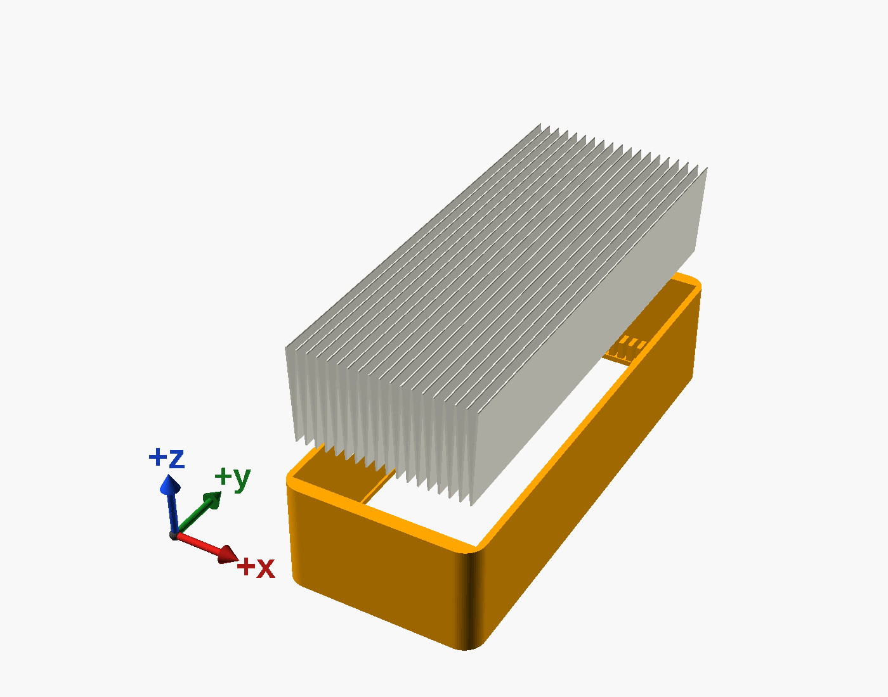

- **The frame.** One ASA frame with the clamp's outline, 100.5 × 40.5 mm and 22.9 mm tall: side walls three
  lines thick, end walls 3 mm, standing 1.5 mm over the paper's top folds, and a rim round its bottom, 1.2 mm
  thick, that stands on the ledge and leaves the ledge's 87.5 × 36.8 mm opening open. No fins: every wall is
  solid, the thinnest place 1.1 mm, at the corners. 1 h 22 m, 11 g.
- **Fins that space the folds** (Alon, 9 Oct 2026: "add small fins at the bottom to help as a jig"). On the rim at
  each end, between the ledge's opening and the end wall, a short fin stands up into every channel open at the
  bottom: 4 mm tall, 1.4 mm wide at the rim and 1 mm at the top, 0.15 mm clear of the paper each side. Lower the
  paper in so a fin goes up into each channel open at the bottom, at both ends, and the paper's bottom folds come
  to rest on the rim between them: the fins set every fold's place, 2.08 mm apart, and hold it while the glue
  sets.

  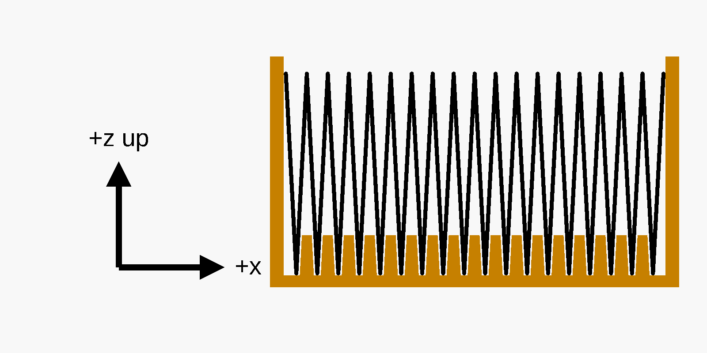
- **The paper.** A piece **94.1 mm long along the folds and 18 pleats across, both long edges cut on a top
  fold**; the frame takes it at 2.08 mm a pleat, 37.4 mm across. It is 7 mm longer than the clamp's piece,
  since nothing reaches into its ends now, and the sheet still gives three pieces.
- **Glue from the top only.** The dirty air comes in at the top, so closing the top closes every way round the
  paper. Stand the paper in the frame on the fins and the rim, its cut ends against the end walls. At each end, fill the end
  of every channel open at the top with glue, down to its bottom fold and a few millimetres along - the glue
  does what the clamp's wedges did. Then run a bead across each end, over the top folds' cut ends and into the
  corner with the end wall, and one along each long side, where the top fold meets the wall. The channels open
  at the bottom end over the rim, which closes them: nothing is needed underneath.
- **Heat.** Ordinary hot-melt glue softens from about 60 °C, and the frame sits in the chamber's air: if the
  chamber runs over about 50 °C, use high-temperature sticks.
- **Try it first.** The glue sample is one end of the frame, 16 mm of it, fins and all (34 m, 3 g). Glue an offcut 16 mm long
  into it as above, and look up through it at a light: none should come round the paper's end or its sides.

### The clamp (shelved)

Two ASA frames with a cut piece of paper between them, screwed together into a
cassette that stands on the ledge, 100.5 × 40.5 mm. It takes a piece 87.1 mm long and 40.3 mm across - 18
pleats and a half each side (D143) - where the bought cartridge is 80 × 40 and the original's pocket took 75.7 ×
37.2 of this paper: 25 % more paper than that.

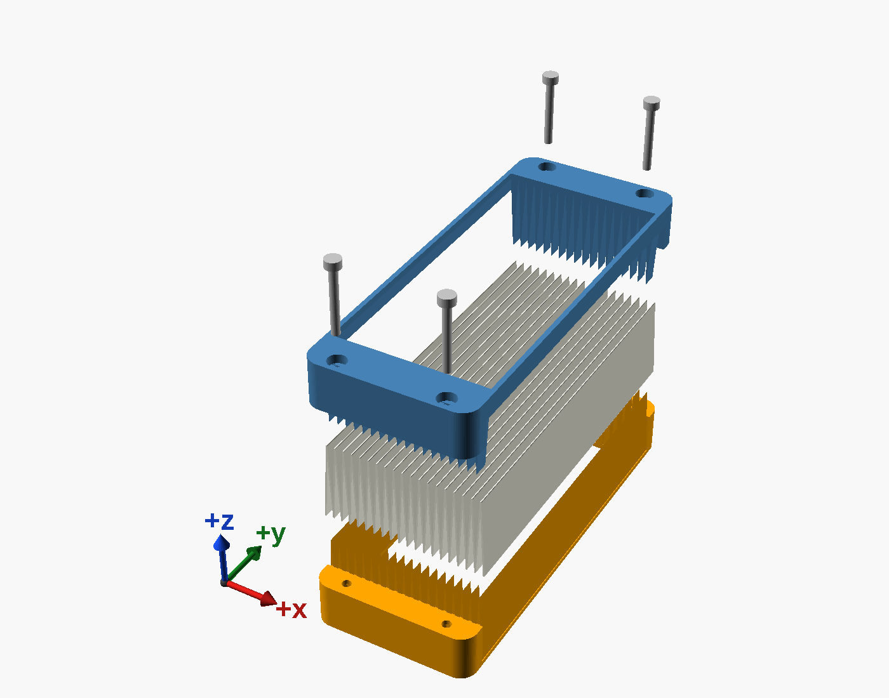

- **Why the ends need closing.** Pleated paper is a row of channels: one open at the top, where the dirty
  air comes in, then one open at the bottom, where it leaves after passing through the paper between them.
  Cut, each channel is open at its ends too, and air could go round the paper there. At each end the upper
  frame has a wedge in every channel open at the top, and the lower frame a tooth in every channel open at
  the bottom, 4 mm into the paper. Screwed together they leave a zigzag slot 0.2 mm wide for 0.4 mm paper:
  the four screws pinch the paper's cut end between the wedges and the teeth. The pleats' walls lean only
  3° from upright, so the last millimetre of the screws' travel closes the slot.
- **The long sides.** The paper runs on half a pleat past its last top fold, down to the lower frame's rim,
  as a flap. The upper frame's half wedge runs down outside it, the whole length, and the lower frame's tooth
  under the last top fold inside it: the screws pinch the flap between them too.
- **One hard stop.** Each end is a block in two halves, the upper frame's on the lower's, and the frames meet
  nowhere else: the band round the top and the rim round the bottom stand 0.2 mm clear of the paper's folds,
  so the slot's width is set by the frames, not by the paper.

  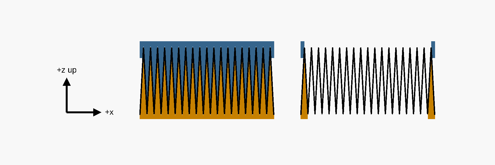
- **The screws.** Four M2 × 16 socket head, two at each end, from the top, their heads sunk in the upper
  frame, into M2 nuts pulled up into seats in the lower frame, as the fans' nuts are in the base. M2, not the
  M2.5 first drawn: an end block is 6.5 mm along the pleats, and an M2.5 nut's pocket leaves it under two
  beads of wall.
- **Cutting the paper.** For this build's paper, 20.2 mm deep, held 2.1 mm between top folds: a piece
  **87.1 mm long along the folds, and 18 pleats across with half a pleat more each side** - both long edges
  cut along a bottom fold. Count the pleats rather than measuring the width: the paper squeezes up tight or
  spreads out, and the clamp spreads it to 40.3. The sheet's 31 pleats make one piece across, and its 300 mm three along: three pieces.
- **Putting it together.** Pull an M2 nut into each of the lower frame's four seats with a spare M2 screw from
  above, and take the screw out: the nut stays. Lay the lower frame down, teeth up, and the paper on it, its
  channels open at the bottom over the teeth at each end and each flap's cut end on the rim outside the long
  teeth. Lower the upper frame on, its wedges into the channels open at the top and its half wedges outside
  the flaps, and drive the four screws until the end blocks meet. Drop the cassette onto the holder's ledge;
  to take it out, lift the holder off the stack and tip it over.
- **Try it first.** The slot's 0.2 mm is a first guess: it pinches the 0.4 mm paper to half. Print the clamp sample
  - one end of each frame, an hour - clamp an offcut 16 mm long in it, and look at the cut end: the paper should
  be pinched all along the zigzag without being cut.

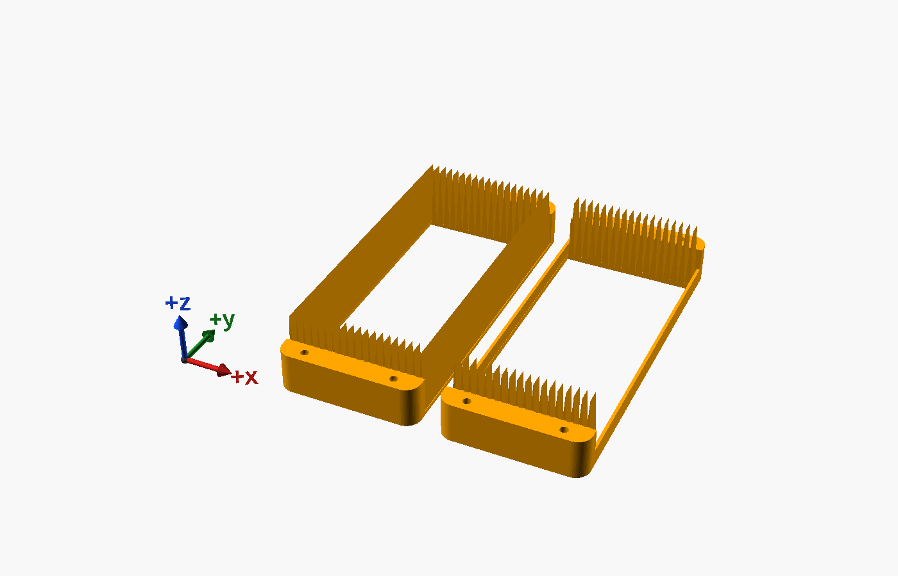

**Other paper:** change its values in [`bentobox.params.scad`](../models/bentobox/bentobox.params.scad) -
`paper_depth` (fold to fold), `paper_pitch` (top fold to top fold) and `paper_t` (its thickness), and
`clamp_slot` a little under `paper_t` - and export the frames again. The clamp stands as tall as the paper is
deep. The pleats across are the whole number nearest to filling it, and the wedges and teeth are placed to
match; rendering either frame echoes the new cut. `paper_flaps = false` cuts the long edges on a top fold
instead.

**Measured** for this build's paper (Alon, 9 Oct 2026, Q95): it is 0.4 mm thick and its folds are 20.2 mm deep;
31 folds squeeze up to about 26 mm. The 2.1 mm between top folds is the clamp's, not the paper's: pleated paper
spreads to any pitch, and `paper_pitch`, 2.12 mm, is chosen for 18 pleats (see *How many pleats*). Anything from
2.07 to 2.17 mm gives the same 18.

**How many pleats** (Alon, 9 Oct 2026: D143, 18). An airflow model of one pleat of
this paper, run for each count the clamp might hold and put into the box's model of the fans and its other
filters ([`sim/bentobox-cfd/pleat.py`](../sim/bentobox-cfd/README.md#one-pleat-of-your-own-paper-how-many-pleats-the-clamp-should-hold)):

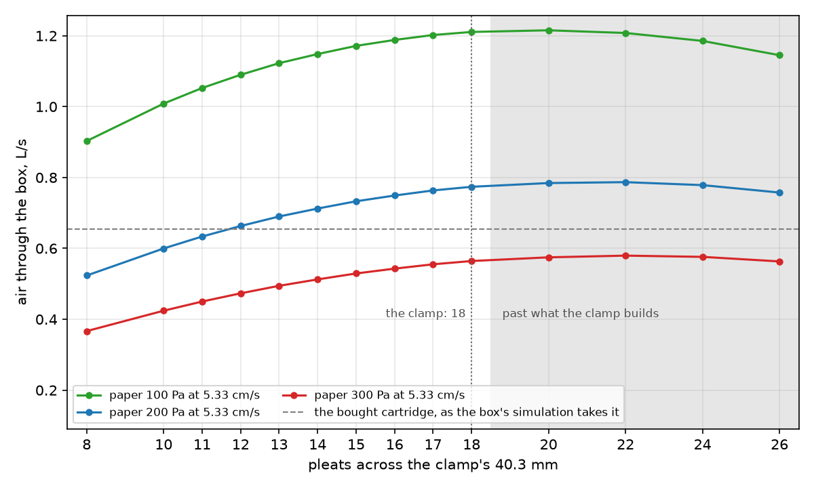

- **The most air comes at 20 to 22 pleats**, whatever the paper's grade, and anything from 18 to 24 is within 3 %
  of it. More pleats put more paper in the air's way, but near each fold the two sheets touch, over more of the
  paper's depth as the pleats close up, and the channels between them narrow; past 22 those cost more than the
  added paper gives.
- **The clamp builds up to 18**: at 19 its half wedges along the long sides come out under 3 mm. At 18 the box
  moves 15 to 25 % more air than at the 11 it held before - 0.77 L/s instead of 0.63 on the middle grade. Against the bought
  cartridge, as the box's simulation takes it, the grade decides: 18 % more air on the middle grade, less on the
  300 Pa one.
- **18 pleats take 19 of the sheet's 31** with the half pleats each side, so the sheet gives three pieces; at 14
  or fewer it gives six. 14 pleats move 8 % less air than 18.
- **The paper's grade is not known**, and it sets how much air, not where the top is: the model runs it at 100,
  200 and 300 Pa across the flat paper at 5.33 cm/s. Checked on a mesh of half the cells' size, every count's drop
  moves by the same 1.4 to 2.1 %.

## The samples

Some of the remix's fits are first guesses, and its big parts are long prints, so the samples come first: every
one of them on two plates, `samples_asa` and `samples_tpu` in [`parts/samples.scad`](../models/bentobox/parts/samples.scad)
(each sample is a part of its own too).

- **The joint sample** and its TPU bead - one end of a sealed joint, and a fan nut's seat (see *The sealed
  joints*).
- **The glue sample** - one end of the glue frame (see *The glue frame*). The clamp's sample still builds, but is
  off the plate. Its trial, T185, was superseded by the bought cartridge (Alon, 14 Oct 2026: Q271).
- **The nut coupon** - on the second ASA plate (below), not the first: five fan-nut seats, numbered 1 to 5 on the top, and five
  tray-nut slots, 6 to 10, open at the front face over a 0.8 mm floor, as in the base. Pull a nut up into each seat
  with an M3 × 8 from the top and take the screw out: which keep their nut? Slide a nut into each slot and drive an
  M3 up from below: which keep it from turning? As cut, across the flats:

  | | |
  |---|---|
  | Seats 1 to 5 | 5.5, 5.6, 5.7, 5.8 and 5.9 mm - 5 was the base's until 10 Oct |
  | Slot 6 | 6.1 mm, its end square: the base's until 10 Oct |
  | Slot 7 | 5.8 mm, its end square |
  | Slot 8 | 6.1 mm, its end the nut's own shape: the nut sits against four walls, its two flats and the two faces behind them, and stops on the screw (Alon's idea) |
  | Slot 9 | 5.8 mm, its end the nut's own shape |
  | Slot 10 | 6.1 mm at its mouth, narrowing to 5.6 on the nut's flats where it stops (Alon's trapezoid) |

  Seat 3 and slot 8 were chosen (see *Tried, 10 Oct*). The coupon keeps these fits as printed. 53 m, 8 g.
- **The bottom sample** - the tray's -Y end, 18 mm of it, and the base's floor over it, 7 mm. Drop the USB-C
  trigger board into its pocket: its socket's face should sit flush with the end face, and a USB-C plug should go
  all the way in, the stop behind the board taking the push. Slide a nut into each of the two slots in the base's
  piece, from the end face, set it on the tray's piece and drive the two M3 × 12 up from below: the pieces should
  pull together, the heads ending flush, and the base's flat bottom closing the socket's notch.
- **The sensor sample** (Alon, 14 Oct 2026: D264) - the base's and the tray's +Y end, from 2 mm in front of the
  SPS30's pocket to the end face, the base cut 2 mm over the SGP41's recess and 2 mm behind the pocket - the back
  wall and its fan post off, as only the area next to the sensors is tried (Alon, 14 Oct 2026): 1 h 56 m and 20 g,
  where the base and the tray whole are 5 h 27 m and 56 g. The SPS30's pocket takes 41 mm of the box's 113, across
  nearly all its width, so the sample cannot be much smaller and still hold it. In the order the box goes together: push the M2.5 nut into
  its seat from the end face, and the M2 nut into its slot; slide the SPS30 in from the outlet's face, its lead
  plugged in - its connector face should meet the end wall, the plug flush with it, the lead bent down the slot;
  set the SGP41 in its recess, its leads down the bay into the slot, and drive its M2.5 × 8 with a 2 mm L-shaped hex
  key from the duct's side: the nut should pull home; lay the leads along the tray's groove, then set the tray's
  piece on, its nub in the base's hole and its stop up through the floor's notch in front of the SPS30, and drive
  the M2 × 16 up from below. The SPS30 should not slide out past the stop.
- **The grommet's coupon and the grommet** - a 3 mm square of the fan section's floor with its grommet hole, in
  ASA, and the grommet, in TPU. Push the grommet into the coupon's hole until it clicks: it should sit flush both
  sides and hold. Then push four spare leads like the fans' through it, one down each groove and through its hole
  in the skin: they should not slide easily, and the skin should hold round each.

**Tried, 9 Oct 2026** (T131), with ASA that was not dry and strung:

- **The USB-C trigger board fits perfectly** in the bottom sample's pocket.
- Of the bottom sample's two tray nuts, one held as its screw was driven; **the other, the one nearer the front,
  spun in its slot**. The two slots are drawn the same and nothing in the model stands near either: a 5.5 mm nut
  in a 6.1 mm slot jams on its corners after about 16 degrees, so that one printed wider, or its nut is small.
- **The fan nut's seat is very loose**: the nut slides in and falls out, and a screw pulling it up does not seat
  it. As cut it is 0.4 mm over the nut. Hence the nut coupon.
- **The TPU bead** sits in the joint's groove and compresses a lot. It stands **0.16 to 0.20 mm** proud of the
  land, where 0.4 is drawn: the bead prints about 0.2 mm under its drawn height. With the joint's one screw done
  up, the sample opens at its far end. The sample is a 30 mm strip with one screw, far floppier than the closed
  rings, but the top joint has only the two end screws, so its 100 mm sides were the question - and **the bead
  still touches all along where the sample opens** (Alon, 9 Oct 2026: Q190): it seals; the faces just do not
  meet there. Nothing changed.
- **The clamp's wedges and teeth** came out thin and fragile: hence the glue frame.

**The second ASA plate**,
`samples_asa_2` in [`parts/samples.scad`](../models/bentobox/parts/samples.scad) (10 Oct 2026): the glue sample
(T185) and the nut coupon (T189), 1 h 25 m and 12 g. The grommet's coupon from the first plate was then still as
drawn, so it is not on it: it waited only on the TPU grommet.

**Tried, 10 Oct 2026** (T189), the nut coupon, in Alon's words:

| | As cut | Result |
|---|---|---|
| Seat 1 | 5.5 mm | doesn't go in |
| Seat 2 | 5.6 mm | too tight |
| Seat 3 | 5.7 mm | **just right** - the base's seats now |
| Seat 4 | 5.8 mm | holds |
| Seat 5 | 5.9 mm, the base's until then | slips out |
| Slot 6 | 6.1 mm, square end, the base's until then | works, the nut is stuck |
| Slot 7 | 5.8 mm, square end | slips in easily, grips with no slippage, falls out easily |
| Slot 8 | 6.1 mm, the nut's own shape | as 7, but does not come out easily - **the base's slots now** |
| Slot 9 | 5.8 mm, the nut's own shape | as 8 |
| Slot 10 | tapered, 6.1 to 5.6 mm | as 7 |

So `pull_fit` is -0.05, and every nut slot - the tray's and the joints' - ends in the nut's own shape at its old
width. Slot 9 did as well as 8, but its fit would also have lowered the slot to the nut's own height, which the
coupon did not try. The nut-shaped end is scad-tools' `nut_slot_hex_end` now.

**Tried, 11 Oct 2026** (T184), the one-piece TPU grommet in the first plate's coupon: it clicks in, sits flush both
sides and holds the leads, but it is a little difficult to click in (Alon: "make the entrance a small amount
larger"). So the floor's hole is chamfered 0.6 mm at its top, where the grommet goes in, from 0.5: as far as the
fan section's +X wall leaves room for, 0.2 mm off it. Above the floor the hole's cut now goes straight up from its
mouth: run on as a cone, as it was, it cut 0.65 mm into the foot of that wall (`check_grommet_wall`).
`grommet-coupon` prints the coupon alone, to try the new entrance.

**Tried, 12 Oct 2026** (T246), the same grommet in a `grommet-coupon` with the 0.6 mm entrance, printed in black
PETG, which was loaded at the time: the entrance is good (Alon, 14 Oct 2026). Nothing changed.

## Printing

Every part prints as its file draws it, standing on its bottom - the section, the base on its floor, the tray,
the fan section, the carbon housing and the HEPA holder - the cover on its top face, the glue frame on its rim,
the clamp's lower frame on its rim and its upper frame turned over onto its band, and a bead ring flat. With the C-MAG, its parts print from their
own files: the tray on its floor, the lid on its top face, the grills flat. No supports, no brim. `sh scripts/tools/bentobox-print.sh` builds every one, checks it and slices
it, its STL and G-code beside its part file in `models/bentobox/.check/`; name parts to build only those - `samples-asa
samples-tpu` for the first two sample plates, `samples-asa-2` for the second ASA one.

| Part | Material | Count | Time | Filament |
|---|---|---|---|---|
| Section | ASA | 1 | 1 h 57 m | 17 g |
| Glue frame (shelved) | ASA | 1 | 1 h 22 m | 11 g |
| Glue sample (shelved) | ASA | 1 | 34 m | 3 g |
| Clamp, lower frame (shelved) | ASA | 1 | 1 h 29 m | 10 g |
| Clamp, upper frame (shelved) | ASA | 1 | 1 h 11 m | 8 g |
| Clamp sample (shelved) | ASA | 1 plate | 1 h 7 m | 7 g |
| Base | ASA | 1 | 3 h 34 m | 36 g |
| Fan section | ASA | 1 | 3 h 43 m | 35 g |
| Tray | ASA | 1 | 1 h 53 m | 20 g |
| Carbon housing | ASA | 1 | 6 h 24 m | 56 g |
| HEPA holder (to be redrawn) | ASA | 1 | 4 h 35 m | 44 g |
| Cover (to be redrawn) | ASA | 1 | 1 h 53 m | 13 g |
| Bead ring | TPU 95A | 3 | 9 m each | 1 g each |
| Joint sample | ASA | 1 plate | 1 h 8 m | 10 g |
| Joint sample's bead | TPU 95A | 1 | 3 m | under 1 g |
| Grommet | TPU 95A | 1 | 2 m | under 1 g |
| Fans' plug mate (on hold) | ASA | 1 | 17 m | 1.7 g |
| Bottom sample | ASA | 1 plate | 45 m | 7 g |
| Sensor sample | ASA | 1 plate | 1 h 56 m | 20 g |
| Nut coupon | ASA | 1 | 53 m | 8 g |
| Grommet's coupon | ASA | 1 | 6 m | 0.9 g |
| Samples, ASA | ASA | 1 plate | 2 h 29 m | 22 g |
| Samples, ASA, second plate | ASA | 1 plate | 1 h 25 m | 12 g |
| Samples, TPU | TPU 95A | 1 plate | 5 m | under 1 g |

Times and weights are PrusaSlicer's, at 0.2 mm with the house profile `0.2mm QUALITY @MK3 - no skirt, no
brim, no crossing perimeter`, as [`scad-check.sh`](https://github.com/AlonRR/scad-tools) slices them, with
`Inslogic TPU 95A` for the bead rings.

For the bottom:

| Quantity | Item |
|---|---|
| 6 | M3 hex nut, ISO 4032 |
| 1 | M2 hex nut, ISO 4032: the tray's +Y end |
| 4 | M3 × 30 socket head cap screw, ISO 4762: the fans |
| 2 | M3 × 12 socket head cap screw, ISO 4762: the tray's -Y end, their heads sunk |
| 1 | M2 × 16 socket head cap screw, ISO 4762: the tray's +Y end, its head sunk |
| 1 | M2.5 × 8 socket head cap screw, ISO 4762: the SGP41 |
| 1 | M2.5 hex nut, ISO 4032: the SGP41's, pushed into its seat from the +Y end face |
| 4 | 6 × 2 mm magnet, optional: the tray's bottom, to hold the box to a steel floor |

For the sealed joints:

| Quantity | Item |
|---|---|
| 6 | M3 hex nut, ISO 4032 |
| 4 | M3 × 30 socket head cap screw, ISO 4762: the carbon housing and the section to the fan section; any from 25 mm |
| 2 | M3 × 12 socket head cap screw, ISO 4762: the HEPA holder to the carbon housing |
| 8 | 6 × 2 mm magnet: the cover's joint, four in the HEPA holder and four in the cover |

For the filters:

| Quantity | Item |
|---|---|
| 1 | HEPA cartridge for the Xiaomi Mijia 1C / Dreame F9 robot vacuum, 150 × 49 × 15 mm: for the bigger holder, not drawn yet (see *A bigger bought cartridge*). It replaces the glue frame's paper (Alon, 14 Oct 2026: Q271) |
| 1 | Polyester filter floss, about 5 mm thick loose: the section's sheet, cut 42 × 102 mm |
| 184 cm³ | Activated carbon pellets: the housing's bed, 45 mm deep, about 83 g |

For the electronics, as the circuit draws them (see *The bottom*):

| Quantity | Item |
|---|---|
| 2 | Delta EFB0412VHD fan, 40 × 40 × 20 mm, 12 V, 3-pin with tach |
| 1 | USB-C PD trigger board, 12 V: in the tray's -Y end |
| 1 | MP1584EN step-down module, 5 V out: for the ESP32 and the SPS30 |
| 1 | ESP32-C3 SuperMini |
| 1 | IRLZ44N N-channel MOSFET: switches both fans |
| 3 | 1N5819 Schottky diode: one across the fans, one in each fan's tach line |
| 1 | 100 Ω resistor: the MOSFET's gate |
| 1 | 10 kΩ resistor: the gate to ground |
| 1 | Sensirion SPS30 particle sensor, and a 5-wire lead for its plug: in the outlet's pocket |
| 1 | Sensirion SGP41 on a GY-SGP41 module: in the end wall's recess |
| | Hookup wire, and a USB-C charger that offers 12 V: many offer 5, 9, 15 and 20 V only |

With the C-MAG: eight 4 × 2 mm magnets, four in each half - its bosses are drawn round the original's. Its parts, in ASA: the tray 2 h 16 m and 25 g, the
lid 1 h 49 m and 21 g, the four grills on one plate 1 h 51 m and 11 g.

For the joint sample, from the same stock: 2 M3 nuts, 1 M3 × 12 and 1 M3 × 8. Every M3 is turned with a
2.5 mm hex screwdriver, its blade 75 mm or longer; the tray's M2 takes a 1.5 mm one, and the SGP41's M2.5 a 2 mm
L-shaped hex key, from inside the duct. For the bottom sample: 2 M3 nuts,
2 M3 × 12 and the USB-C trigger board. For the sensor sample: an M2 nut and an M2 × 16, an M2.5 nut and an
M2.5 × 8, the SPS30 with its lead and the SGP41. For the nut coupon: an M3 nut for each seat and slot, or one moved
along, and an M3 × 8.

For the glue frame, shelved: a hot-glue gun and sticks, high-temperature ones if the chamber runs hot.

For the paper's clamp, shelved:

| Quantity | Item |
|---|---|
| 4 | M2 hex nut, ISO 4032 |
| 4 | M2 × 16 socket head cap screw, ISO 4762, and a spare to pull the nuts in with |

## The air through it

This is the original's stack, with the C-MAG and the bought cartridge; the remix's paper and its bed of carbon are
compared under *How many pleats* and *The carbon*. An airflow simulation of the whole stack, standing on the chamber's floor with the chamber's air round it:
OpenFOAM, the two Deltas on their published curve, the filters as resistances, on [the LunchBox's](../archive/lunchbox/docs/lunchbox-scrubber.md#the-air-through-it)
assumptions but one. The HEPA cartridge's grade is not known, and it sets the flow more than anything
else: the numbers are for the LunchBox's mid-grade paper, folded into this cartridge's 15 mm pleats instead
of 19 mm, which leaves it 15/19 of the paper and so 19/15 of the resistance - a judgement, not a
measurement. How it is built and every assumption in it: [`sim/bentobox-cfd/`](../sim/bentobox-cfd/README.md).

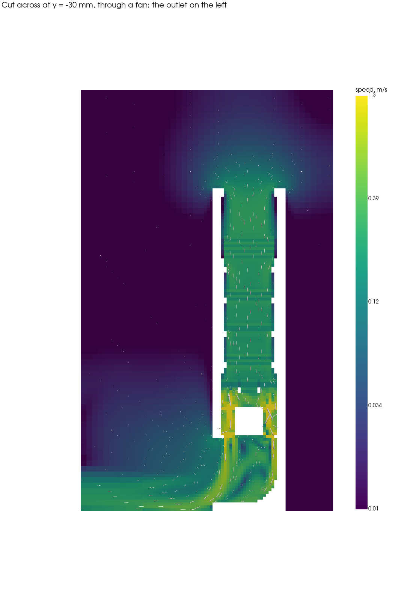

| | As designed | With the section | Section, trays full |
|---|---|---|---|
| Air through the filters | 0.69 L/s | 0.68 L/s | 0.58 L/s |
| ...by the lumped model | 0.68 L/s | 0.65 L/s | 0.57 L/s |
| The HEPA cartridge takes | 91 Pa | 87 Pa | 74 Pa |
| The C-MAG takes | 6 Pa | 6 Pa | 20 Pa |
| The section's sheet takes | | 4 Pa | 3 Pa |
| Time the air spends in the carbon | 81 ms | 83 ms | 387 ms |
| The chamber's 139 L through it every | 3.4 min | 3.4 min | 4.0 min |

- **The HEPA cartridge sets the flow.** It takes about nine tenths of what the fans can give. Its paper sees
  only the 78 × 37 mm opening of the original's ledge (the remix's is 90 × 37, for a bigger piece of paper;
  these numbers are for the original), where the LunchBox's paper sees 70 cm², more than twice as
  much. So the BentoBox moves about half the LunchBox's air (1.3 to 1.5 L/s with its leaks sealed), and
  turns the chamber over every 3.4 minutes where the LunchBox does it every 1.5 to 1.8. Without the
  19/15 for its shallower pleats - the very same resistance per face as the LunchBox's paper - the lumped
  model gives 0.79 L/s with the section, and the simulation would come out near 0.8: three fifths of the
  LunchBox's air rather than half.
- **The remix as decided moves 0.72 L/s** by the lumped model (18 pleats, the 45 mm bed, the section; see *The
  carbon*): 2.6 m³ an hour, the chamber's 139 L every 3.2 minutes, 19 times an hour. The chamber is a Lack
  table's 55 × 55 cm and 46 cm tall, the 40 cm under the table's top and 6 cm more (Alon, 9 Oct 2026: Q157); the
  legs and the printer take a little of it. With the chamber's air well mixed and the paper stopping what passes,
  a cloud of particles halves every 2.2 minutes: 90 % gone in about 7.5 minutes, 99 % in about 15. Each time
  scales with the chamber's volume, and the flow with the paper's grade, which is not known.
- **The section costs little**: 1.5 % of the flow in the simulation, 4 % by the lumped model. The two
  differ by about as much as the meshes of two cases do. Its sheet is evenly loaded: 0.15 m/s on average,
  nowhere below 0.12, a little less over the grid's two long ribs (on the 1 mm mesh, below).

  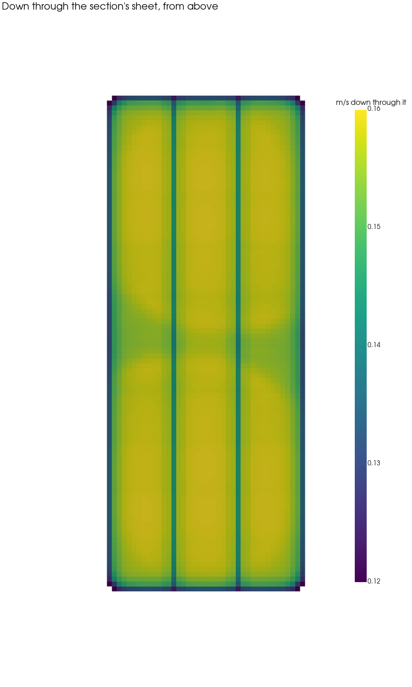
- **Filling the C-MAG's trays full costs a seventh of the flow and quadruples the carbon**: 222 cm³ instead
  of 55, more than the LunchBox's 150, and the air spends nearly five times as long in it. The carbon is
  not what limits this box's flow, so carbon here is cheap.
- **Simulated with ThrutheFrame's duct**, not the Auto's base (see *The bottom*).
- **No leaks in the model.** The air in at the cover and out at the duct agree to within 2 %, and to 1 % on
  every plane between them, and nothing gets round the C-MAG. The model's joints are closed, though; the
  real ones under suction are sealed, and the Auto's wires' hole wants sealing (see *The sealed joints* and
  *The bottom*).
- **Checked on a finer mesh** (1 mm instead of 2, with the section): the air through the filters comes out
  3.5 % lower, **0.65 L/s** instead of 0.68 - the lumped model's figure - and the chamber goes through it
  every 4.6 minutes. The cover, the HEPA's ledge, the housing's floor, the sheet and the fan case's floor
  now carry the same air to within 0.05 %. The other two cases are likely high by about as much, so read
  the table's flows as about 3 % generous; its comparisons between them stand.
- **None of its own air comes back in.** The duct throws the fans' air out along the floor, and the inlet
  is on top, 23 cm above it: in the air modelled round the box, none of it gets back there. A real
  chamber's walls turn it, so take it as a sign, not a number, as on the LunchBox's page.

  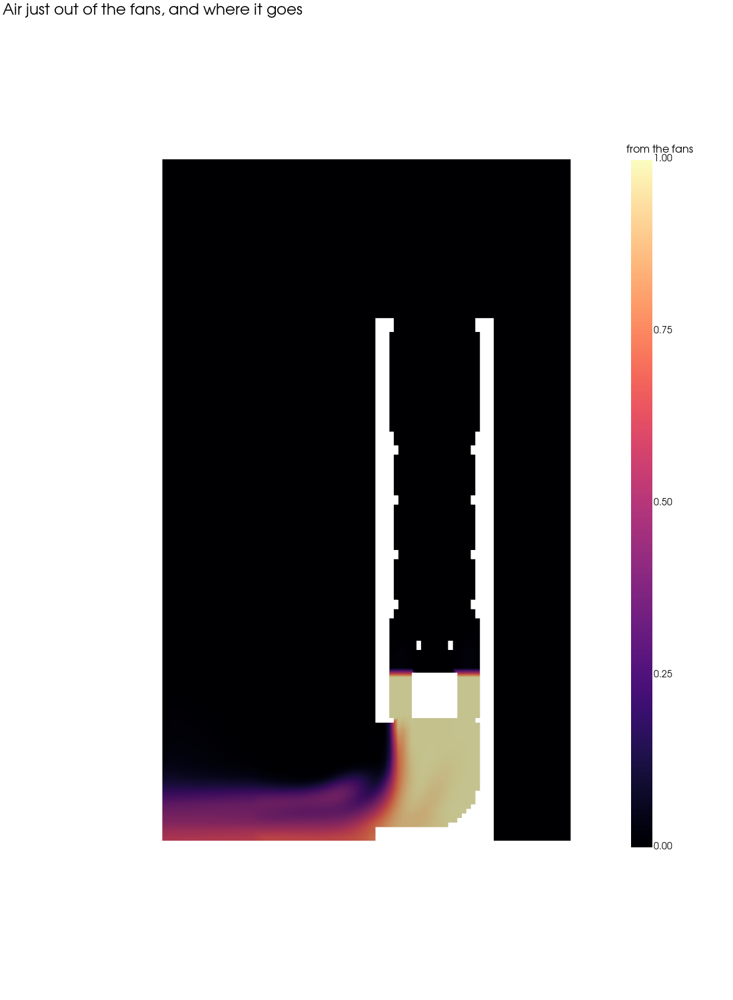

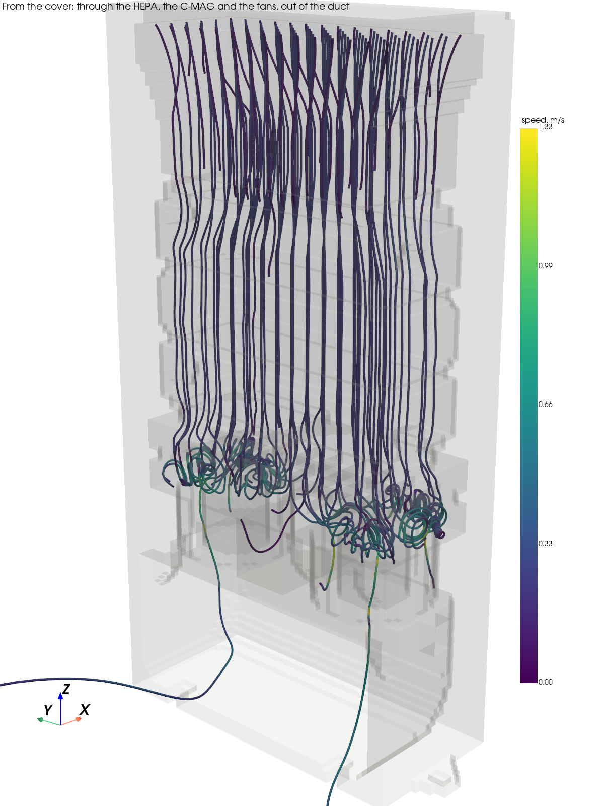

## How long the carbon lasts

An estimate, from [`scripts/analysis/carbon-life.py`](../scripts/analysis/carbon-life.py), which says where each number comes
from:

- **The carbon** is AP4-60: 4 mm pellets of steam-activated coal, so acid-free in the sense the BentoBox's
  author asks for. Its data sheet gives 450 kg/m³, and how much benzene it holds at four concentrations; an
  isotherm fitted to those, and carried over to styrene, says how much it holds at a chamber's concentration.
- **The fumes** from ASA: 0.5 to 3.5 mg of VOCs an hour of printing, 1.5 in the middle. UL's consolidated
  chamber tests put three quarters of all printers' totals under 1 mg/h and the worst cases, ASA among them,
  over 3. On a Prusa i3, ASA gave off under a quarter of ABS's styrene.
- **The chamber**: every fume goes through the carbon, which sits at 45 °C during an ASA print.

A scrubber keeps the chamber's air clean enough that the carbon only ever sees tens to hundreds of
micrograms of styrene a cubic metre, and there it takes up only 3 to 7 % of its own weight - not the 20 to
40 % a data sheet shows at high concentrations. The BentoBox moves less air, so its chamber runs about twice
as concentrated, and each gram of its carbon holds a little more.

| | Carbon | ASA print hours until it is spent | Range, 3.5 to 0.5 mg/h |
|---|---|---|---|
| LunchBox | 150 cm³, 68 g | about 1,850 | 1,000 to 3,900 |
| BentoBox, the C-MAG filled to its line | 55 cm³, 25 g | about 850 | 460 to 1,800 |
| BentoBox, its trays filled full | 222 cm³, 100 g | about 3,500 | 1,900 to 7,500 |
| The remix: a 45 mm bed, with the paper clamp | 184 cm³, 83 g | about 2,700 | 1,500 to 5,800 |

"Spent" is the carbon in equilibrium with the chamber's air. It lets more through well before then, so
change it sooner: when the smell comes back during a print. Damp air shortens it too - the carbon sits at
room humidity between prints - and whatever the extraction carries out lengthens it.

The lighter fumes, ASA's acrylonitrile among them, stick to plain carbon poorly, and either box lets some
of them through from the start. The HEPA is not what wears out: printing gives off particles by the
billion, but they weigh micrograms.

## Checking it

The model's rules are asserts in [`checks/guards.scad`](../models/bentobox/checks/guards.scad) and warnings in
[`checks/report.scad`](../models/bentobox/checks/report.scad); the fit checks' views are the model's `draw` menu.
The fits are checked against the original's STLs, which have to be in
[`models/bentobox/original/`](../models/bentobox/original/), with the Auto's written there from its STEP:

```sh
uv run scripts/tools/bentobox-auto-stl.py                                # the Auto's STLs, from its STEP
OPENSCAD="<the OpenSCAD nightly>" uv run scripts/checks/bentobox-checks.py all
```

For the sealed joints it stands each upper part on its lower one - flat on the land, its chamfer in the
collar, tab on tab - lays each bead in its groove, runs each screw from its head to its tip through the tabs
and the section's pillars, pulls a nut up into each tab's seat and draws it back down its pocket and out past the
bracket, and stands a hex
screwdriver on each screw's head, straight up, with nothing in its way. With `sealed=false` it checks the original's joints: the section against
the carbon housing above it and the fan section below it, a magnet across each joint through both parts'
holes. It runs the air's way from the housing's floor - its honeycomb, or with the C-MAG its two openings - down through
the section. It stands the cover on the HEPA holder, its plug in the holder's top, a magnet across the joint
at each corner. With `carbon = "cmag"` it stands the C-MAG in the carbon housing, clear of its walls and of the HEPA holder; and
it closes the C-MAG's lid
on its tray, a magnet across their joint at each corner, and sets the four grills in their slots. It stands the glue frame in the cut-out HEPA holder, the paper in the frame against its walls, and keeps the
ledge's opening clear of the frame's rim. For the paper's clamp, with `hepa_frame = "clamp"`, it stands the cassette in the cut-out HEPA holder, sets the
upper frame on the lower one - meeting only at the end blocks - lays a model of the paper, drawn from its own
values at the slot's thickness, in the frames' zigzag, keeps the air's way down under the paper open, and
runs the four screws through the end blocks and the nuts into their seats and down out of them. It sets the
grommet in the fan section's floor, lip in groove. It seats the fans' plugs, drawn from their measurements, on
their mate, ribs either side of each key and clear of the walls; finds the grip's ribs biting their ends (a check that must not come out empty) and, the bite taken off, clear of them; and runs the wires' cores up through the block
into the plugs' holes. For the bottom it stands the fan
section on the base and the base on the tray, lays the USB-C board in its pocket - its socket through its notch,
flush with the end face - sets a nut in each of the tray's slots and slides it out through
the end face, and one in each fan screw's seat and draws it down its pocket and out under its post, keeps two
beads of the end wall round each tray slot and its screw's hole, runs each screw from its head to its tip, and
the wires down the tube, and the fans' air down into the base past the posts, and keeps the grommet's hole from
cutting into the fan section's wall above the floor. For the outlet's sensors it lays the SPS30 in its pocket and
the SGP41 in its recess, clear of the base and the fan section, with open air in front of each; stands the SPS30's
plug in the end wall's slot; slides the SPS30 in from the outlet, the tray off, and finds the tray's stop in front
of it, close enough that 1 mm out the SPS30 meets it (the other check that must not come out empty); runs both sensors' leads down the slot and along the tray's groove; seats the SGP41's screw and nut and
slides the nut in from the end face; and swings a 2 mm L-shaped hex key on its screw, the fan section off. Each
must come out empty. Every check has a positive control,
something broken on purpose that it must catch, and the run fails if one passes unnoticed: 59 fits and
81 controls.

[`bentobox.params.scad`](../models/bentobox/bentobox.params.scad) holds the original's dimensions, measured
by sectioning its STLs, and every setting of the section and of the paper's frame; the bought parts' own numbers -
the fans, their plug, the USB-C board, the screws and nuts, the magnets, the cartridge, the paper, the pellets -
are under [`vitamins/`](../models/bentobox/vitamins/).

## Credit and licence

BentoBox v2.0 is © ThrutheFrame, under [CC BY-NC-SA 4.0](https://creativecommons.org/licenses/by-nc-sa/4.0/).
The BentoBox Auto VOC Sensor system, whose base and fan section the bottom is drawn after, is © Strangwooduk,
under the same licence as a remix of it.
The remix — the models in [`models/bentobox/`](../models/bentobox/) and the pictures in [`bentobox/`](diagrams/bentobox/)
— is under CC BY-NC-SA 4.0 too: free to use and share, not for sale.
